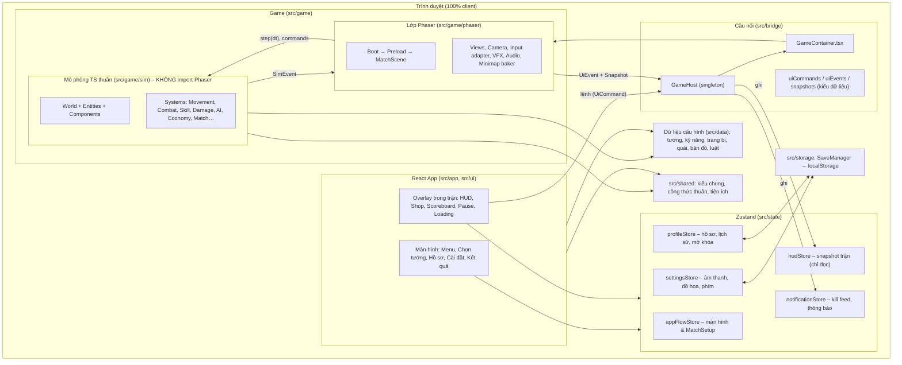
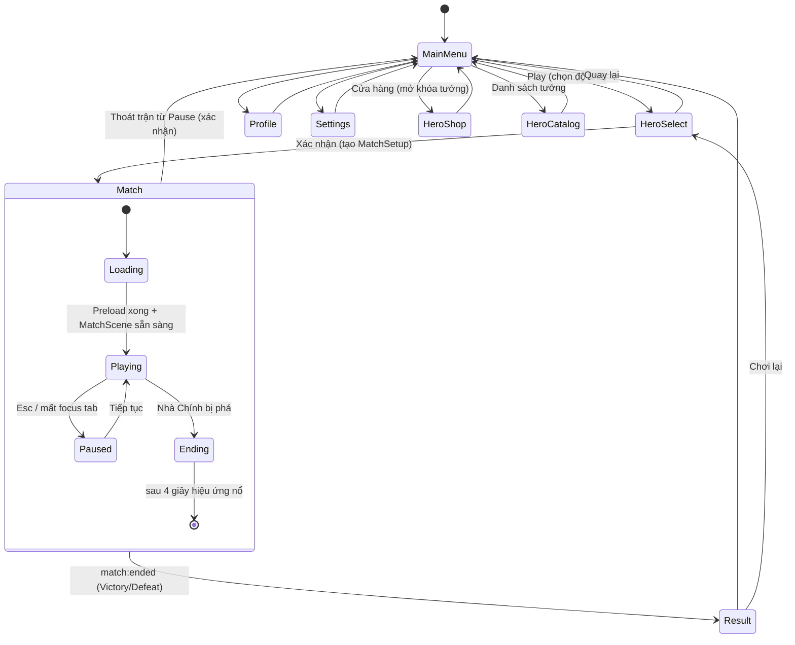
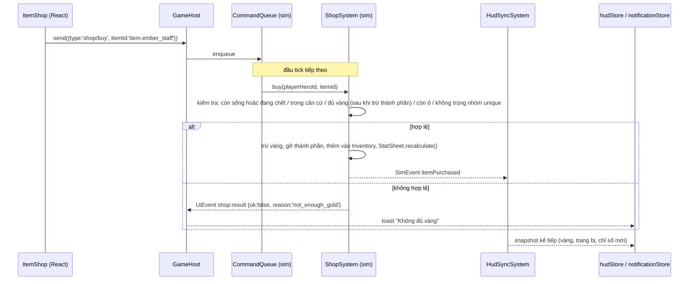

# 01 – Kiến trúc tổng thể

## 1. Các lớp của hệ thống



### 1.1 Trách nhiệm từng lớp

| Lớp | Thư mục | Trách nhiệm | Không được làm |
|-----|---------|-------------|----------------|
| Shared | `src/shared` | Kiểu dữ liệu nguyên thủy (Id, Team, Vec2, StatBlock), **công thức thuần** dùng chung cho sim và UI (giảm sát thương, ước tính scaling cho tooltip, giá ghép trang bị), tiện ích (assert, Result, format thời gian, logger) | Import bất kỳ lớp nào khác |
| Data | `src/data` | Định nghĩa tướng, kỹ năng, trang bị, lính, trụ, quái, bản đồ, luật kinh tế/tiến cấp, hồ sơ AI, phím mặc định + **trình kiểm tra toàn vẹn dữ liệu** | Chứa logic gameplay, import Phaser/React |
| Sim | `src/game/sim` | Toàn bộ logic trận: entity, system, AI, kỹ năng, va chạm, điều hướng, kinh tế, luật thắng thua. Chạy được trong Node (Vitest) | Import `phaser`, `react`, `zustand`, `src/bridge`, `src/state`; dùng `setTimeout`/`Date.now()` (chỉ dùng `SimClock`) |
| Phaser | `src/game/phaser` | Tạo `Phaser.Game`, scene, tải asset, vòng lặp fixed-step, render entity theo snapshot sim, chiếu isometric, camera, đọc input → `UnitIntent`, VFX, âm thanh, minimap nền | Quyết định luật chơi (mọi quyết định thuộc sim) |
| Bridge | `src/bridge` | Vòng đời Phaser trong React; kênh lệnh UI→Game; kênh sự kiện + snapshot Game→UI; ghi vào store | Chứa logic gameplay |
| State | `src/state` | Zustand store cho UI, settings, profile, snapshot trận | Sửa dữ liệu trận trực tiếp |
| UI / App | `src/ui`, `src/app` | Màn hình, overlay, HUD, component; gửi lệnh qua `GameHost` | Import `src/game/**` |
| Storage | `src/storage` | Đọc/ghi localStorage an toàn, version, validate, migrate | Gọi từ sim |

### 1.2 Quy tắc phụ thuộc (được kiểm tra bằng ESLint)

```
shared   ← (không phụ thuộc gì)
data     ← shared
storage  ← shared, data(types)
game/sim ← shared, data
game/phaser ← game/sim, data, shared, bridge/contracts (chỉ kiểu + emitter)
bridge   ← game/phaser (createGame), state, shared
state    ← shared, data(types), storage
ui, app  ← state, bridge (GameHost, GameContainer, contracts), data (đọc catalog), shared
```

Thực thi bằng `no-restricted-imports` trong `eslint.config.js` theo từng thư mục (không cần plugin thêm). Ví dụ: file trong `src/game/sim/**` import `phaser` ⇒ lỗi lint ⇒ CI/build-check thất bại.

## 2. Luồng màn hình (App Flow)

Không dùng router URL (ADR-07). `appFlowStore` là một state machine:



Ánh xạ sang trạng thái trận trong đặc tả: `Waiting` = MainMenu, `HeroSelection` = HeroSelect, `Loading`/`Playing`/`Paused` = trong Match, `Victory`/`Defeat` = Result (kèm `winner`).

## 3. Tích hợp React ↔ Phaser

### 3.1 Vòng đời

```mermaid
sequenceDiagram
  participant UI as MatchScreen (React)
  participant GC as GameContainer
  participant GH as GameHost (singleton)
  participant PG as Phaser.Game
  participant MS as MatchScene
  UI->>GC: mount (props: matchSetup)
  GC->>GH: start(parentDiv, matchSetup)
  alt đã có instance (StrictMode mount lần 2 / lỗi)
    GH->>PG: destroy(true) instance cũ
  end
  GH->>GH: await import('@/game/phaser/createGame') (lazy chunk)
  GH->>PG: new Phaser.Game(config, parent)
  PG->>MS: Boot → Preload (phát load:progress) → MatchScene.init(matchSetup)
  MS-->>GH: emit 'match:ready'
  GH-->>UI: appFlowStore.matchPhase = 'playing'
  UI->>GC: unmount (rời trận)
  GC->>GH: stop()
  GH->>MS: SHUTDOWN → dispose systems, listeners, pools, timers
  GH->>PG: destroy(true); instance = null
```

**Chi tiết bắt buộc:**

- `GameHost` giữ tối đa **1** instance. `start()` gọi khi đã có instance ⇒ hủy cái cũ trước. Có token (`generation`) để bỏ qua kết quả `import()` trễ của lần mount bị hủy (StrictMode mount → unmount → mount).
- `GameContainer` chỉ render một `<div ref>` kích thước 100% và gọi `GameHost.start/stop` trong `useEffect`. Không truyền state React thay đổi liên tục vào Phaser.
- Scale mode `Phaser.Scale.RESIZE`; overlay React đặt `position:absolute` phía trên canvas, `pointer-events:none` cho vùng trống và `pointer-events:auto` cho widget.
- Mọi scene đăng ký `this.events.once(Phaser.Scenes.Events.SHUTDOWN, dispose)`; mọi system trong sim có `dispose()`. Mọi `on()` của emitter đều có `off()` tương ứng (pattern `Disposable`/`DisposableBag`).
- Phaser được **import động** ⇒ Main Menu không tải ~1 MB của Phaser (NFR-03).

### 3.2 Truyền MatchSetup

`MatchSetup` (xem `02-entity-va-system.md`) được tạo ở HeroSelect, lưu trong `appFlowStore`, truyền vào `GameHost.start()` → `game.registry.set('matchSetup', setup)` → `MatchScene.init()` đọc và gọi `MatchSimulation.create(setup)`. Sau khi trận bắt đầu, React không sửa `MatchSetup` nữa.

### 3.3 Phân xử bàn phím & chuột

| Tình huống | Xử lý |
|-----------|-------|
| Đang mở Shop/Pause/Settings (modal) | `GameHost.send({type:'input/setUiBlocking', blocking:true})` ⇒ PhaserInputAdapter bỏ qua phím gameplay (trừ Esc, phím mở/đóng Shop) |
| Ô nhập liệu React đang focus (đổi tên, đổi phím) | Kiểm tra `document.activeElement` là input/textarea ⇒ không xử lý phím game |
| Chuột phải trên canvas | `contextmenu` bị chặn trên canvas (không chặn toàn trang) |
| Phím trình duyệt (Ctrl+W, F5, Tab) | Không cho gán vào phím gameplay; Tab dùng cho Scoreboard với `preventDefault` khi canvas có focus |
| Tab trình duyệt bị ẩn | `visibilitychange` ⇒ tự Pause; khi quay lại, delta bị kẹp (tối đa 4 bước sim) |

## 4. Luồng dữ liệu

Có **5 kênh**, mỗi kênh một chiều và có kiểu rõ ràng:

| Kênh | Chiều | Cơ chế | Ví dụ |
|------|-------|--------|-------|
| K1. Dữ liệu cấu hình | `src/data` → sim & UI | import tĩnh, chỉ đọc (`as const` + `readonly`) | Danh sách tướng cho màn chọn tướng; chỉ số tướng cho sim |
| K2. Thiết lập trận | React → Game (1 lần) | `GameHost.start(parent, MatchSetup)` | Tướng người chơi, độ khó, seed, đội hình AI |
| K3. Lệnh | React → Game | `GameHost.send(UiCommand)` → `CommandQueue` → tiêu thụ **đầu bước sim kế tiếp** | `shop/buy`, `shop/sell`, `skill/levelUp`, `match/pause`, `camera/focus`, `settings/apply` |
| K4. Sự kiện rời rạc | Game → React | Emitter có kiểu `UiEventMap` | `match:ready`, `load:progress`, `kill`, `structure:destroyed`, `objective:spawned`, `shop:result`, `player:levelUp`, `match:ended` |
| K5. Snapshot liên tục | Game → React | `HudSyncSystem` dựng `HudSnapshot` **10 Hz** (minimap 5 Hz) → `hudStore.setState` theo từng lát (slice) và chỉ khi thay đổi | Máu, năng lượng, cooldown, vàng, trang bị, thời gian, tỉ số, scoreboard |

Thêm kênh lưu trữ: `settingsStore`/`profileStore` ⇄ `SaveManager` ⇄ localStorage (ghi có debounce, không ghi trong lúc chiến đấu trừ khi người chơi đổi cài đặt).

### 4.1 Ví dụ: mua trang bị



Nút "Mua" ở UI được bật/tắt dựa trên **báo giá** (`shopQuotes`) do sim tính và gửi trong snapshot khi Shop đang mở – UI không tự quyết định có mua được hay không, sim vẫn kiểm tra lại.

### 4.2 Ví dụ: hạ gục tướng

`DamageSystem` gây sát thương chí mạng → `Health` về 0 → SimEvent `unitDied {victim, killer, assists[]}` → các bên nghe: `EconomySystem` (vàng), `ExperienceSystem` (KN), `RespawnSystem` (đặt hẹn hồi sinh), `MatchStatsTracker` (KDA), `UiEventForwarder` (UiEvent `kill` → kill feed), `VfxDirector` & `AudioDirector` (phía Phaser).

### 4.3 Ví dụ: đổi cài đặt trong trận

Settings (React) → `settingsStore.update()` → `SaveManager.save()` (debounce 500 ms) → đồng thời `GameHost.send({type:'settings/apply', audio, graphics, bindings})` → `AudioManager.setVolumes()`, `PhaserInputAdapter.setBindings()`, `QualityManager.apply()`.

## 5. Vòng lặp mô phỏng

```ts
// MatchScene.update(time, deltaMs) – phác thảo
accumulator += Math.min(deltaMs, 250) / 1000;   // kẹp delta khi tab bị ẩn
let steps = 0;
while (accumulator >= SIM_DT && steps < MAX_STEPS_PER_FRAME) { // SIM_DT = 1/30, MAX = 4
  sim.step(SIM_DT, inputAdapter.collectIntents());
  accumulator -= SIM_DT; steps++;
}
renderSync.apply(sim.world, accumulator / SIM_DT);   // alpha nội suy vị trí
```

- Sim chỉ dùng `SimClock` (thời gian game). Không `setTimeout`, không `Date.now()` trong sim.
- RNG tất định (`Mulberry32(seed)`), mỗi hệ thống có luồng RNG con riêng để thêm/bớt hệ thống không làm lệch toàn bộ.
- Pause = không gọi `sim.step`; Phaser tween/particle của VFX cũng tạm dừng (`scene.tweens.pauseAll()`, time scale = 0).

## 6. Hệ tọa độ & phép chiếu isometric

### 6.1 Ba hệ tọa độ

| Hệ | Đơn vị | Dùng cho |
|----|--------|---------|
| **Lưới (grid)** | ô `(col, row)`, 0..119 | Điều hướng A*, địa hình, bụi, tường |
| **Thế giới (world)** | đơn vị, 0..7680, `CELL = 64` | Toàn bộ logic: vị trí, tầm, va chạm, kỹ năng |
| **Màn hình iso (screen)** | pixel thế giới Phaser | Render, camera, chuột |

### 6.2 Công thức (tile iso 128 × 64)

```
worldToScreen:  sx = (x − y) + OFFSET_X        OFFSET_X = 7680
                sy = (x + y) / 2 − z           z = độ cao (đạn bay, nhảy)
screenToWorld:  x = sy + (sx − OFFSET_X) / 2
                y = sy − (sx − OFFSET_X) / 2
gridToWorld:    x = (col + 0.5) × CELL,  y = (row + 0.5) × CELL
depth:          depth = (x + y) / 2  (điểm chân) + layerBias
```

- Hình tròn bán kính r trong world hiển thị thành **elip** rộng `2r`, cao `r` – vòng tầm đánh, vùng kỹ năng được vẽ bằng elip để khớp logic.
- Chuột: `camera.getWorldPoint()` → `screenToWorld()` → đích click-to-move / hướng kỹ năng.
- Minimap: `worldToMinimap` chiếu cùng phép iso rồi co tỉ lệ, nên minimap có hình thoi giống bản đồ (căn cứ Xanh bên trái, Đỏ bên phải, Mid nằm ngang). `minimapToWorld` là phép ngược để click minimap di chuyển camera.
- `IsoProjector` có unit test round-trip (`screenToWorld(worldToScreen(p)) ≈ p`).

### 6.3 Sắp xếp chiều sâu

Nền đất là Phaser Tilemap isometric (Phaser tự cull ô ngoài camera). Vật thể (tướng, lính, trụ, cây, đá) đặt `depth` theo chân. Cây/công trình cao che tướng ⇒ giảm alpha khi tướng người chơi đứng phía sau (occlusion fade).

## 7. Cấu trúc thư mục

```
F:\MA\                                  (gốc dự án)
├── IMG/                                Ảnh tham khảo – KHÔNG import, KHÔNG copy vào public
├── docs/                               Tài liệu (GĐ 00) + docs/qa/phase-XX.md (checklist kiểm thử)
├── public/
│   └── assets/
│       ├── atlases/                    *.png + *.json (texture atlas theo nhóm)
│       ├── tiles/                      tileset isometric
│       ├── images/                     portrait/splash (WebP), logo
│       ├── audio/music/ · audio/sfx/   OGG + MP3
│       ├── fonts/                      font tự host (OFL)
│       └── CREDITS.md                  nguồn & giấy phép từng asset
├── scripts/                            pack-atlas, optimize-images, check-ip (grep IMG/ trong dist)
├── src/
│   ├── main.tsx · App.tsx · vite-env.d.ts
│   ├── app/
│   │   ├── ScreenRouter.tsx            render màn hình theo appFlowStore
│   │   ├── ErrorBoundary.tsx
│   │   └── layouts/MainLayout.tsx
│   ├── ui/
│   │   ├── components/                 Button, Panel, Modal, Tooltip, Bar, IconFrame, Tabs, KeyCap…
│   │   ├── screens/
│   │   │   ├── main-menu/  hero-select/  hero-catalog/  hero-shop/
│   │   │   ├── profile/    settings/     result/        match/ (MatchScreen)
│   │   ├── overlays/                   LoadingOverlay, PauseMenu, Scoreboard, ItemShop/
│   │   ├── hud/                        TopBar, Minimap, PlayerPanel, AbilityBar, ItemBar, BuffBar,
│   │   │                               KillFeed, Announcer, RecallBar, DeathOverlay
│   │   └── hooks/                      useGameEvent, useHudSlice, useHotkeyHint…
│   ├── state/
│   │   ├── appFlowStore.ts  settingsStore.ts  profileStore.ts
│   │   ├── hudStore.ts      notificationStore.ts
│   ├── bridge/
│   │   ├── GameHost.ts                 singleton: start/stop/send/on
│   │   ├── GameContainer.tsx
│   │   ├── TypedEmitter.ts
│   │   ├── uiCommands.ts  uiEvents.ts  snapshots.ts   (chỉ kiểu – "hợp đồng")
│   │   └── storeSync.ts                route UiEvent/Snapshot vào store
│   ├── game/
│   │   ├── phaser/
│   │   │   ├── createGame.ts           cấu hình Phaser (lazy entry)
│   │   │   ├── scenes/                 BootScene, PreloadScene, MatchScene
│   │   │   ├── assets/                 manifest.ts, assetKeys.ts, placeholderArt.ts
│   │   │   ├── render/                 IsoProjector.ts, RenderSync.ts, views/ (HeroView, MinionView,
│   │   │   │                           StructureView, MonsterView, ProjectileView, ZoneView),
│   │   │   │                           BarPool.ts, FloatingTextPool.ts, TelegraphRenderer.ts, OcclusionFader.ts
│   │   │   ├── map/                    MapRenderer.ts, MinimapBaker.ts, DecorationPlacer.ts
│   │   │   ├── input/                  PhaserInputAdapter.ts, CursorTargeting.ts
│   │   │   ├── camera/                 CameraController.ts
│   │   │   ├── vfx/                    VfxDirector.ts, ParticlePool.ts
│   │   │   ├── audio/                  AudioDirector.ts
│   │   │   └── debug/                  DebugOverlay.ts (FPS, ms sim, số entity, lưới nav)
│   │   └── sim/
│   │       ├── MatchSimulation.ts      facade: create(setup), step(dt, intents), command(), snapshot()
│   │       ├── core/                   World.ts, EntityRegistry.ts, SimClock.ts, Rng.ts, SpatialHash.ts,
│   │       │                           ObjectPool.ts, StateMachine.ts, SimEventBus.ts, Disposable.ts, CommandQueue.ts
│   │       ├── math/                   vec2.ts, geometry.ts (circle/cone/line/swept)
│   │       ├── entities/               Entity.ts, Unit.ts, Hero.ts, Minion.ts, Monster.ts, Boss.ts,
│   │       │                           Structure.ts, Tower.ts, Core.ts, Fountain.ts, Projectile.ts, AreaZone.ts
│   │       ├── components/             StatSheet.ts, Health.ts, ResourcePool.ts, StatusEffects.ts,
│   │       │                           Cooldowns.ts, Inventory.ts, Experience.ts, Wallet.ts, Collider.ts
│   │       ├── controllers/            UnitIntent.ts, IntentApplier.ts
│   │       ├── systems/                (xem 02-entity-va-system.md)
│   │       ├── combat/                 DamageCalculator.ts, AttackResolver.ts
│   │       ├── skills/                 SkillCaster.ts, SkillExecutor.ts, targeting.ts,
│   │       │                           effects/ (damage, heal, shield, status, dash, knockback,
│   │       │                           projectile, zone, buff, blink), custom/ (hook riêng từng tướng)
│   │       ├── ai/                     perception/Perception.ts, team/TeamBrain.ts,
│   │       │                           hero/HeroBrain.ts, hero/states/*.ts, hero/roles/*.ts,
│   │       │                           minion/MinionBrain.ts, monster/MonsterBrain.ts, boss/BossBrain.ts
│   │       ├── navigation/             NavGrid.ts, AStar.ts, PathSmoother.ts, LanePaths.ts, PathService.ts
│   │       ├── map/                    MapBuilder.ts (MapConfig → NavGrid, vùng, vị trí), mirror.ts
│   │       ├── factories/              HeroFactory, MinionFactory, MonsterFactory, StructureFactory
│   │       ├── match/                  MatchRules.ts, MatchStatsTracker.ts, DraftService.ts
│   │       └── headless/               runHeadlessMatch.ts (cho test & cân bằng)
│   ├── data/
│   │   ├── types/                      HeroDefinition, SkillDefinition, ItemDefinition… (interface)
│   │   ├── heroes/                     index.ts + 1 file/tướng
│   │   ├── skills/                     1 file/tướng (passive + Q/W/E/R) + monsterSkills.ts
│   │   ├── items/                      index.ts + theo nhóm (attack, magic, defense, speed, support, regen)
│   │   ├── units/                      minions.ts, structures.ts, monsters.ts, boss.ts
│   │   ├── maps/                       arena01.config.ts
│   │   ├── rules/                      progression.ts, economy.ts, waves.ts, respawn.ts, combat.ts, buffs.ts
│   │   ├── ai/                         difficulty.ts, roleProfiles.ts
│   │   ├── input/                      defaultBindings.ts
│   │   ├── meta/                       achievements.ts, unlocks.ts
│   │   └── validate.ts                 kiểm tra id trùng, tham chiếu hỏng, mảng theo cấp đủ độ dài…
│   ├── storage/                        safeStorage.ts, SaveManager.ts, schema.ts, migrations.ts, validators.ts
│   ├── shared/
│   │   ├── types/                      ids.ts, team.ts, stats.ts, geometry.ts
│   │   ├── rules/                      mitigation.ts, scaling.ts, recipeCost.ts, cooldown.ts
│   │   └── utils/                      assert.ts, result.ts, format.ts, logger.ts
│   └── styles/index.css                Tailwind + biến màu theme
├── tests/                              test tích hợp & headless (unit test đặt cạnh file: *.test.ts)
├── index.html · package.json · tsconfig.json · tsconfig.node.json
├── vite.config.ts · eslint.config.js · .prettierrc · .gitignore
```

## 8. Quy ước code

| Chủ đề | Quy ước |
|--------|---------|
| TypeScript | `strict`, `noUncheckedIndexedAccess`, `noImplicitOverride`, `noFallthroughCasesInSwitch`, `noUnusedLocals`, `noUnusedParameters`, `verbatimModuleSyntax`. Cấm `any` (lint), hạn chế `as` |
| Alias | `@/` → `src/` (Vite + tsconfig `paths`) |
| Id | `DefinitionId` dạng chuỗi có tiền tố: `hero.thorne`, `skill.thorne.q`, `item.iron_sword`, `monster.blue_sentinel`. `EntityId` là số tăng dần trong trận |
| Lỗi | Lệnh từ UI trả `Result<T, ReasonCode>` (không throw cho lỗi nghiệp vụ). Lỗi lập trình dùng `assert()` (throw trong dev, log trong prod). `ErrorBoundary` ở React; lỗi trong Phaser scene được bắt và chuyển thành UiEvent `fatal` ⇒ màn hình báo lỗi + nút về Menu |
| Null | Truy cập Map/mảng luôn kiểm tra (do `noUncheckedIndexedAccess`); entity đã chết/được hủy kiểm tra `isAlive`/`isActive` trước khi dùng |
| Kích thước | File ≤ ~300 dòng, component React ≤ ~150 dòng; vượt ⇒ tách |
| Dữ liệu | Không số "ma thuật" trong logic: mọi giá trị cân bằng nằm ở `src/data` |
| Văn bản UI | Tiếng Việt, gom trong `src/ui/i18n/vi.ts` để dễ đổi ngôn ngữ |
| Cấm | `TODO`, `FIXME`, hàm rỗng, nút không có hành động. Script `npm run check:placeholders` grep các mẫu này và fail |
| Test | Vitest cho `shared`, `data`, `game/sim`, `storage`; React Testing Library cho component có logic |

## 9. Công cụ & cấu hình

| Hạng mục | Lựa chọn |
|----------|---------|
| Phiên bản | Khóa chính xác (không `^`) trong GĐ 01 sau khi kiểm tra tương thích: React 18/19, Vite (bản ổn định hiện hành), Phaser **3.x** mới nhất, Tailwind CSS v4 qua `@tailwindcss/vite` (nếu cần hỗ trợ trình duyệt cũ hơn Safari 16.4 thì dùng v3.4 + PostCSS), Zustand 5, Vitest |
| Scripts | `dev`, `build`, `preview`, `typecheck` (`tsc -b --noEmit`), `lint`, `test`, `test:headless`, `check:placeholders`, `assets:pack` |
| Vite | `base` lấy từ `VITE_BASE` (mặc định `/`; GitHub Pages: `/<repo>/`). Asset Phaser load qua `import.meta.env.BASE_URL`. `build.rollupOptions.output.manualChunks` tách `phaser` |
| Font | Tự host qua `public/assets/fonts` hoặc gói `@fontsource/*` (giấy phép OFL), có hỗ trợ tiếng Việt |
