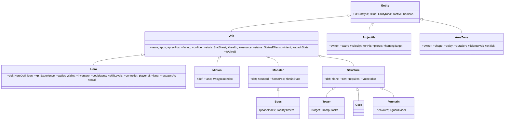
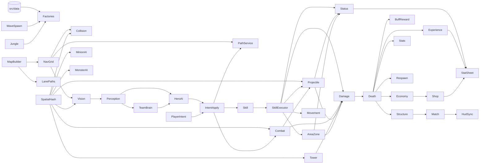

# 02 – Entity, Component, System & Mô hình dữ liệu

Phong cách: **Entity class gọn + Component dữ liệu + System xử lý**. Không dùng ECS thuần (quá phức tạp cho giai đoạn đầu), cũng không nhồi logic vào class entity. Entity chỉ giữ dữ liệu và vài phương thức truy vấn đơn giản; mọi thay đổi trạng thái theo thời gian do System thực hiện.

## 1. Cây Entity



| Entity | Số lượng tối đa ước tính | Ghi chú |
|--------|--------------------------|---------|
| Hero | 10 | `Hero` base class + `HeroDefinition` dữ liệu; hành vi riêng của tướng qua kỹ năng dữ liệu + hook `custom/` |
| Minion | ~90 đồng thời | Pool |
| Monster/Boss | 22 (10 trại ≈ 20 con + Rồng + Boss) | |
| Structure | 22 (2 × (6 trụ đường + 2 hộ vệ + Nhà Chính + Bệ hồi sinh)) | |
| Projectile | ~150 | Pool |
| AreaZone | ~40 | Pool (vùng lửa, bẫy, cảnh báo Boss) |

## 2. Component dữ liệu

| Component | Nội dung | Ai ghi |
|-----------|---------|--------|
| `StatSheet` | `base` (theo cấp) + danh sách `StatModifier` (trang bị, buff, debuff) → `final` (cache, đánh dấu dirty khi đổi) | StatSystem, ShopSystem, StatusEffectSystem |
| `Health` | `current`, `shields[] {amount, expiresAt, sourceId}`, `lastDamagedAt`, `lastDamagedBy` (theo dõi assist 10 giây) | DamageSystem, HealSystem |
| `ResourcePool` | Năng lượng (mana) `current/max`, regen | SkillSystem, RegenSystem |
| `StatusEffects` | Danh sách hiệu ứng đang có (slow, stun, silence, burn, poison, knockback, buff tùy biến) + cờ tổng hợp `canMove/canAttack/canCast` | StatusEffectSystem |
| `Cooldowns` | Thời điểm sẵn sàng của Q/W/E/R, đánh thường, biến về | SkillSystem, CombatSystem |
| `Inventory` | 6 ô `ItemInstance {defId, cooldownReadyAt, stacks}` | ShopSystem |
| `Experience` | `level`, `xp`, `skillPoints` | ExperienceSystem |
| `Wallet` | `gold`, `totalEarned` | EconomySystem, ShopSystem |
| `Collider` | `radius`, `isStatic`, `blocksMovement`, `layer` | — (dữ liệu) |
| `UnitIntent` | Ý định của tick này: `move {dir | point}`, `attack {target | dir}`, `cast {slot, target | point | dir}`, `stop`, `recall`, `lockTarget` | PlayerController / AiController |

## 3. Danh sách System

Tần suất: **T** = mỗi tick sim (30 Hz). Các hệ "nặng" chạy thưa và **so le** (stagger) để chia tải giữa các tick.

| # | System | Trách nhiệm | Tần suất | Phụ thuộc |
|---|--------|------------|----------|-----------|
| S01 | `CommandSystem` | Lấy lệnh UI từ `CommandQueue` (mua/bán, nâng kỹ năng, pause…) chuyển cho system đích | T | — |
| S02 | `PlayerIntentSystem` | Nhận intent từ PhaserInputAdapter cho tướng người chơi (chuột → world đã đổi ở lớp Phaser) | T | — |
| S03 | `TeamBrainSystem` | Chiến lược cấp đội: phân đường, mục tiêu (Rồng/Boss/đẩy/thủ), nhóm giao tranh | 1 Hz | Perception, MatchState |
| S04 | `HeroAISystem` | `HeroBrain` FSM từng tướng AI → `UnitIntent` | 4–7 Hz theo độ khó, so le | Perception, TeamBrain, PathService, SkillCaster (kiểm tra khả dụng) |
| S05 | `MinionAISystem` | Đi theo lane, chọn mục tiêu theo luật ưu tiên | 5 Hz so le | SpatialHash, LanePaths |
| S06 | `MonsterAISystem` | FSM quái: Idle→Detect→Chase→Attack→Return→Dead→Respawn | 5 Hz | SpatialHash |
| S07 | `BossSystem` | Giai đoạn theo % máu, chọn kỹ năng, tạo `AreaZone` cảnh báo trước | T | MonsterAI, SkillExecutor |
| S08 | `TowerSystem` | Chọn mục tiêu theo luật trụ, bắn đạn, tăng sát thương liên tiếp lên tướng | 5 Hz chọn mục tiêu, T bắn | SpatialHash, CombatEventLog |
| S09 | `IntentApplySystem` | Chuyển `UnitIntent` thành hành động: đặt đích di chuyển/đường A*, bắt đầu đánh, yêu cầu cast | T | PathService, SkillCaster |
| S10 | `SkillSystem` | Đường ống cast 10 bước (sống → năng lượng → hồi chiêu → tầm → mục tiêu → thực thi → sát thương → trạng thái → hiệu ứng → cooldown), thời gian vận chiêu | T | SkillExecutor, DamageSystem, StatusEffectSystem |
| S11 | `CombatSystem` | Đánh thường: tầm, windup, chờ tốc đánh, cận chiến gây sát thương ngay / tầm xa sinh đạn | T | ProjectileSystem, DamageSystem |
| S12 | `MovementSystem` | Đi theo hướng/đường, gia tốc, tốc chạy (đã tính slow), lướt/đẩy lùi cưỡng bức | T | NavGrid |
| S13 | `CollisionSystem` | Đẩy tách hình tròn giữa các unit (mềm), chặn tường lưới, giữ trong bản đồ | T | SpatialHash, NavGrid |
| S14 | `ProjectileSystem` | Bay thẳng/đuổi mục tiêu, va chạm quét (swept) để không xuyên khi 30 Hz, xuyên mục tiêu, hết tầm | T | SpatialHash, SkillExecutor |
| S15 | `AreaZoneSystem` | Vùng có trễ (cảnh báo), tick sát thương/hiệu ứng, hết hạn | T | SkillExecutor |
| S16 | `DamageSystem` | Xử lý hàng đợi `DamageRequest`: giảm trừ giáp/kháng phép → khiên → máu → hút máu → ghi log → phát `unitDamaged`/`unitDied` | T | DamageCalculator (shared/rules) |
| S17 | `StatusEffectSystem` | Áp/gia hạn/hết hạn hiệu ứng, tick Burn/Poison, tổng hợp cờ `canMove/canCast`, modifier vào StatSheet | T | DamageSystem |
| S18 | `RegenSystem` | Hồi máu/năng lượng, hồi máu ở Bệ hồi sinh | T (tích lũy) | — |
| S19 | `RecallSystem` | Vận biến về, ngắt khi trúng đòn/di chuyển, dịch chuyển về Bệ | T | — |
| S20 | `DeathSystem` | Xử lý chết: dọn mục tiêu, hủy cast, đánh dấu entity, trả pool lính/quái | theo sự kiện | — |
| S21 | `RespawnSystem` | Hẹn hồi sinh tướng, hồi sinh quái theo trại | T | — |
| S22 | `EconomySystem` | Vàng thụ động, thưởng hạ gục/hỗ trợ/lính/quái/trụ, chuỗi hạ gục | T + sự kiện | — |
| S23 | `ExperienceSystem` | KN chia trong bán kính, lên cấp, điểm kỹ năng, tăng chỉ số | sự kiện | StatSystem |
| S24 | `ShopSystem` | Mua/bán/ghép, báo giá cho UI, AI mua đồ | lệnh | Economy, StatSystem |
| S25 | `WaveSpawnSystem` | Sinh đợt lính theo lịch, tăng chỉ số theo thời gian, lính được cường hóa khi có buff Boss | T | MinionFactory |
| S26 | `JungleSystem` | Lịch xuất hiện trại, Rồng, Boss; thông báo | T | MonsterFactory |
| S27 | `BuffRewardSystem` | Gán buff Bùa Xanh/Đỏ, cộng dồn Rồng, buff Boss; chuyển Bùa cho kẻ hạ người đang giữ | sự kiện | StatusEffectSystem |
| S28 | `StructureSystem` | Chuỗi bảo vệ trụ (`vulnerable`), giảm sát thương khi không có lính địch gần (chống "đánh lén") | sự kiện + 2 Hz | — |
| S29 | `VisionSystem` | Tầm nhìn từng đội (bụi cỏ chặn), cung cấp `Perception` cho AI và cờ hiển thị cho render | 10 Hz | SpatialHash, NavGrid |
| S30 | `MatchSystem` | Thời gian trận, tỉ số, kiểm tra Nhà Chính → `matchEnded` | T | — |
| S31 | `MatchStatsTracker` | KDA, sát thương gây/nhận, hồi máu, vàng, lính, quái, trụ cho màn kết quả | sự kiện | — |
| S32 | `HudSyncSystem` | Dựng `HudSnapshot` (10 Hz), `MinimapSnapshot` (5 Hz), `ScoreboardSnapshot` (2 Hz hoặc khi đang giữ Tab) | thấp tần | — |
| S33 | `UiEventForwarder` | Lọc SimEvent → UiEvent (kill feed, Boss, phá trụ, lên cấp, kỹ năng sẵn sàng) | sự kiện | — |

**Phía Phaser (không thuộc sim, chạy mỗi frame render):** `RenderSync` (tạo/hủy/cập nhật view, nội suy), `CameraController`, `PhaserInputAdapter`, `VfxDirector`, `AudioDirector`, `TelegraphRenderer`, `FogRenderer` (tùy chọn chất lượng), `MinimapBaker` (1 lần), `DebugOverlay`.

## 4. Thứ tự cập nhật một tick

```
1. CommandSystem, PlayerIntentSystem                ← đầu vào
2. TeamBrain → HeroAI → MinionAI → MonsterAI → Boss → Tower(chọn mục tiêu)   ← quyết định
3. IntentApplySystem                                ← intent → hành động
4. SkillSystem → CombatSystem                       ← sinh DamageRequest / Projectile / Zone / Dash
5. MovementSystem → CollisionSystem                 ← di chuyển & va chạm
6. ProjectileSystem → AreaZoneSystem                ← trúng đích → DamageRequest / Status
7. DamageSystem → StatusEffectSystem → RegenSystem  ← áp sát thương, hiệu ứng
8. DeathSystem → Economy / Experience / BuffReward / Structure / StatsTracker (qua SimEventBus, xử lý cuối tick)
9. RecallSystem → RespawnSystem → WaveSpawnSystem → JungleSystem
10. VisionSystem (10 Hz)
11. MatchSystem                                     ← kiểm tra thắng/thua
12. HudSyncSystem, UiEventForwarder                 ← đầu ra cho UI
```

`SimEventBus` gom sự kiện trong tick và **phát ở cuối bước 7/8** để tránh thay đổi danh sách entity khi đang duyệt.

## 5. Đồ thị phụ thuộc giữa các hệ thống



**Thứ tự xây dựng suy ra từ đồ thị:** core/math → Map/NavGrid → Entity + StatSheet → Movement/Collision → Damage/Status → Skill/Combat/Projectile → Minion/Tower/Structure → Economy/Experience → Jungle/Boss → Vision/Perception → AI → Shop → Match/Stats → HUD/VFX/Audio. Khớp với lộ trình trong `04-ke-hoach-phat-trien.md`.

## 6. Sự kiện miền (SimEvent)

`unitSpawned`, `unitDamaged {target, source, amount, type, isCrit}`, `unitHealed`, `shieldApplied`, `unitDied {victim, killer, assists}`, `heroRespawned`, `heroLevelUp`, `skillCast {caster, skillId}`, `skillReady {hero, slot}`, `statusApplied`, `projectileSpawned`, `projectileHit`, `zoneTelegraph {shape, delay}`, `goldGained`, `itemPurchased`, `itemSold`, `structureDestroyed`, `structureVulnerable`, `campSpawned`, `objectiveSpawned {kind}`, `objectiveKilled {kind, team}`, `buffGained`, `recallStarted/Cancelled/Completed`, `matchEnded {winner}`.

## 7. Mô hình dữ liệu (TypeScript)

> Đây là **thiết kế hợp đồng dữ liệu**, sẽ được hiện thực trong `src/shared/types` và `src/data/types` ở GĐ 01/04. Tên trường có thể tinh chỉnh khi code nhưng cấu trúc giữ nguyên.

### 7.1 Kiểu dùng chung

```ts
export type EntityId = number;
export type DefinitionId = string;               // 'hero.thorne', 'item.iron_sword'
export type PlayableTeam = 'blue' | 'red';
export type TeamId = PlayableTeam | 'neutral';
export type LaneId = 'top' | 'mid' | 'bot';
export interface Vec2 { x: number; y: number }

export interface StatBlock {
  maxHp: number; hpRegen: number;                // regen theo giây
  maxMana: number; manaRegen: number;
  attackDamage: number; abilityPower: number;
  armor: number; magicResist: number;
  moveSpeed: number;                             // đơn vị/giây
  attackSpeed: number;                           // đòn/giây
  attackRange: number;                           // đơn vị world
  critChance: number; critMultiplier: number;    // 0..1, mặc định 1.75
  abilityHaste: number;                          // cd = base × 100/(100+haste)
  lifeSteal: number; spellVamp: number;          // 0..1
  armorPenFlat: number; armorPenPct: number;
  magicPenFlat: number; magicPenPct: number;
  healShieldPower: number;                       // 0..1, tăng hồi máu/khiên cho đồng minh
}
export type StatKey = keyof StatBlock;
export interface StatModifierSpec { stat: StatKey; mode: 'flat' | 'percent'; value: number }

export type DamageType = 'physical' | 'magic' | 'true';
export interface Scaling {                       // giá trị theo cấp kỹ năng + hệ số chỉ số
  base: readonly number[];
  adRatio?: number; bonusAdRatio?: number; apRatio?: number;
  maxHpRatio?: number; targetMaxHpRatio?: number;
}
```

### 7.2 Hero

```ts
export type HeroRole = 'fighter' | 'mage' | 'marksman' | 'tank' | 'assassin' | 'support';
export type Position = 'top' | 'jungle' | 'mid' | 'carry' | 'support';

export interface BasicAttackDefinition {
  kind: 'melee' | 'ranged';
  damageType: DamageType;                        // thường 'physical'
  windupRatio: number;                           // phần thời gian trước khi gây sát thương (0.2–0.35)
  projectile?: { speed: number; visual: string };
}

export interface HeroDefinition {
  id: DefinitionId; name: string; title: string; lore: string;
  role: HeroRole; secondaryRole?: HeroRole;
  positions: readonly Position[];                // vị trí phù hợp, dùng cho draft AI
  difficulty: 1 | 2 | 3;
  resource: 'mana' | 'none';
  baseStats: StatBlock;                          // tại cấp 1
  growth: Partial<StatBlock>;                    // cộng mỗi cấp
  attack: BasicAttackDefinition;
  passiveId: DefinitionId;
  skills: { q: DefinitionId; w: DefinitionId; e: DefinitionId; r: DefinitionId };
  collisionRadius: number;
  art: { portrait: string; icon: string; atlas: string; animPrefix: string; scale: number };
  ai: { profile: DefinitionId; buildPath: readonly DefinitionId[]; skillOrder: readonly ('q'|'w'|'e'|'r')[] };
  unlock: { byDefault: boolean; honorCost?: number };
}
```

### 7.3 Skill & hiệu ứng

```ts
export type SkillSlot = 'q' | 'w' | 'e' | 'r';
export interface TargetFilter { enemies: boolean; allies: boolean; self: boolean; heroes: boolean; minions: boolean; monsters: boolean; structures: boolean }

export type SkillTargeting =
  | { kind: 'self' }
  | { kind: 'unit'; range: number; filter: TargetFilter }           // chọn mục tiêu
  | { kind: 'direction'; range: number }                            // định hướng (skillshot)
  | { kind: 'point'; range: number; radius: number };               // diện rộng tại điểm

export type AreaShape =
  | { kind: 'circle'; radius: number }
  | { kind: 'cone'; radius: number; angleDeg: number }
  | { kind: 'line'; length: number; width: number };

export type StatusKind = 'slow' | 'stun' | 'silence' | 'burn' | 'poison' | 'statBuff';
export interface StatusSpec {
  kind: StatusKind; duration: readonly number[] | number;
  magnitude?: number;                       // slow: 0.3 = chậm 30%; poison: giảm hồi máu
  tick?: { interval: number; damage: Scaling; damageType: DamageType };   // burn/poison
  modifiers?: readonly StatModifierSpec[];  // statBuff
  stacking: 'refresh' | 'strongest' | 'stack';
  maxStacks?: number;
}

export type EffectSpec =
  | { type: 'damage'; damageType: DamageType; amount: Scaling; area?: AreaShape; filter?: TargetFilter }
  | { type: 'heal'; amount: Scaling; to: 'self' | 'target' | 'alliesInArea'; area?: AreaShape }
  | { type: 'shield'; amount: Scaling; duration: number; to: 'self' | 'target' | 'alliesInArea'; area?: AreaShape }
  | { type: 'status'; status: StatusSpec; to: 'self' | 'target' | 'area'; area?: AreaShape }
  | { type: 'knockback'; distance: number; duration: number; from: 'caster' | 'areaCenter' }
  | { type: 'dash'; distance: number; speed: number; direction: 'aim' | 'backward' | 'toTarget';
      stopOnFirstHit?: boolean; onArrive?: readonly EffectSpec[] }
  | { type: 'blink'; maxDistance: number; to: 'point' | 'behindTarget' }
  | { type: 'projectile'; speed: number; maxRange: number; radius: number; pierce: number;
      homing: boolean; visual: string; onHit: readonly EffectSpec[] }
  | { type: 'zone'; shape: AreaShape; delay: number; duration: number; tickInterval: number;
      onTick: readonly EffectSpec[]; telegraph: boolean; visual: string }
  | { type: 'custom'; handler: string; params?: Readonly<Record<string, number>> };  // hook trong sim/skills/custom

export interface SkillDefinition {
  id: DefinitionId; heroId?: DefinitionId; slot: SkillSlot | 'passive' | 'monster';
  name: string; description: string;              // mẫu: "Gây {damage} sát thương phép…"
  icon: string;
  maxLevel: number;                               // Q/W/E: 4, R: 3
  cooldown: readonly number[]; manaCost: readonly number[];
  castTime: number;                               // giây đứng yên vận chiêu (0 = tức thì)
  targeting: SkillTargeting;
  effects: readonly EffectSpec[];
  ai: { use: 'damage' | 'engage' | 'escape' | 'peel' | 'heal' | 'shield' | 'farm' | 'buff';
        minTargets?: number; hpThreshold?: number };
  vfx?: string; sfx?: string;
}

export interface PassiveDefinition {
  id: DefinitionId; name: string; description: string; icon: string;
  trigger: 'onAttackHit' | 'onSkillHit' | 'everyNthAttack' | 'onKill' | 'whileLowHp' | 'aura' | 'interval';
  params: Readonly<Record<string, number>>;
  effects: readonly EffectSpec[];
}
```

### 7.4 Item

```ts
export type ItemCategory = 'attack' | 'magic' | 'defense' | 'speed' | 'support' | 'regen';
export type ItemTier = 'consumable' | 'basic' | 'advanced' | 'legendary' | 'boots';

export type ItemPassiveSpec =
  | { kind: 'onHitDamage'; damageType: DamageType; amount: Scaling; vsMonsterMultiplier?: number }
  | { kind: 'onSkillHitStatus'; status: StatusSpec; internalCooldown: number }
  | { kind: 'lowHpShield'; hpThreshold: number; amount: Scaling; cooldown: number }
  | { kind: 'aura'; radius: number; affects: 'allies' | 'enemies'; modifiers: readonly StatModifierSpec[] }
  | { kind: 'thorns'; returnRatio: number };

export interface ItemDefinition {
  id: DefinitionId; name: string; icon: string; description: string;
  category: ItemCategory; tier: ItemTier;
  totalCost: number;                       // giá đầy đủ; giá thực = totalCost − giá thành phần đang có
  components: readonly DefinitionId[];     // trang bị ghép
  stats: readonly StatModifierSpec[];
  passives: readonly ItemPassiveSpec[];
  active?: { cooldown: number; effects: readonly EffectSpec[] };
  consumable?: { maxStack: number; effects: readonly EffectSpec[] };
  uniqueGroup?: string;                    // ví dụ 'boots' – chỉ giữ 1
  sellRatio: number;                       // mặc định 0.6
  recommendedFor: readonly HeroRole[];
}
```

### 7.5 Minion & lịch đợt lính

```ts
export type MinionKind = 'melee' | 'ranged' | 'siege';
export interface MinionDefinition {
  id: DefinitionId; kind: MinionKind; name: string;
  stats: StatBlock; growthPerStep: Partial<StatBlock>;   // mỗi 90 giây
  attack: BasicAttackDefinition;
  reward: { gold: number; xp: number };
  collisionRadius: number; acquisitionRange: number;
  art: { atlas: string; animPrefix: string; teamMask: boolean };
}
export interface WaveSchedule {
  firstWaveAt: number; interval: number;
  composition: readonly MinionKind[];        // ['melee','melee','melee','ranged','ranged']
  siegeEveryNthWave: number; scalingStep: number;
}
```

### 7.6 Tower & công trình

```ts
export type StructureKind = 'outerTower' | 'innerTower' | 'guardTower' | 'core' | 'fountain';
export interface StructureDefinition {
  id: DefinitionId; kind: StructureKind; name: string;
  maxHp: number; armor: number; magicResist: number; hpRegen: number;
  attack?: { damage: number; interval: number; range: number; projectileSpeed: number;
             heroRampPerHit: number; maxRamp: number };      // sát thương tăng dần khi bắn liên tiếp vào tướng
  backdoorDamageReduction: number;                            // khi không có lính địch gần
  reward: { teamGold: number; lastHitGold: number; xp: number };
  collisionRadius: number;
  art: { atlas: string; intact: string; damaged: string; rubble: string };
}
export interface StructurePlacement {
  placementId: string;                    // 'blue.top.outer'
  definitionId: DefinitionId; team: PlayableTeam;
  lane: LaneId | 'base'; position: Vec2;
  requires: readonly string[];            // placementId phải bị phá trước (chuỗi phá trụ)
  requiresMode: 'all' | 'any';
}
```

### 7.7 Monster & Boss

```ts
export type MonsterKind = 'small' | 'large' | 'blueBuff' | 'redBuff' | 'dragon' | 'boss';
export interface MonsterDefinition {
  id: DefinitionId; name: string; kind: MonsterKind;
  stats: StatBlock; attack: BasicAttackDefinition;
  detectRange: number;             // phạm vi phát hiện / gọi bầy
  leashRange: number;              // rời xa nhà quá mức ⇒ Return
  aggressive: boolean;             // false: chỉ đánh khi bị tấn công
  firstSpawnAt: number; respawnTime: number;
  reward: { gold: number; xp: number; teamGold?: number;
            buff?: { buffId: DefinitionId; target: 'killer' | 'team' } };
  skills: readonly DefinitionId[];
  art: { atlas: string; animPrefix: string; scale: number };
}
export interface BossPhase {
  hpBelow: number;                 // 1.0, 0.6, 0.3
  abilities: readonly { skillId: DefinitionId; cooldown: number; weight: number }[];
  modifiers?: readonly StatModifierSpec[];        // ví dụ cuồng nộ: +40% tốc đánh
  announce: string;
}
export interface BossDefinition extends MonsterDefinition { phases: readonly BossPhase[]; telegraphTime: number }
export interface CampPlacement {
  campId: string; side: PlayableTeam | 'river';
  position: Vec2; members: readonly { definitionId: DefinitionId; offset: Vec2 }[];
}
```

### 7.8 Map

```ts
export interface MapConfig {
  id: DefinitionId; gridSize: number; cellSize: number;           // 120, 64
  lanes: Record<LaneId, { waypoints: readonly Vec2[]; width: number }>;   // định nghĩa phía Xanh → Đỏ
  river: { path: readonly Vec2[]; width: number };
  walls: readonly Polygon[];        // vật cản (phía Xanh; phía Đỏ sinh bằng đối xứng tâm)
  brushes: readonly Polygon[];
  baseZones: Record<PlayableTeam, Polygon>;
  fountains: Record<PlayableTeam, Vec2>;
  structures: readonly StructurePlacement[];   // phía Xanh
  camps: readonly CampPlacement[];             // phía Xanh + 2 hang sông
  decorations: readonly { kind: string; position: Vec2 }[];
  mirror: 'pointSymmetric';                    // (x,y) → (W−x, W−y)
}
```

### 7.9 Match

```ts
export type MatchPhase = 'waiting' | 'heroSelection' | 'loading' | 'playing' | 'paused' | 'victory' | 'defeat';
export type Difficulty = 'easy' | 'normal' | 'hard';

export interface SlotSetup { heroId: DefinitionId; controller: 'player' | 'ai'; position: Position; displayName: string }
export interface MatchSetup {
  seed: number; mapId: DefinitionId; difficulty: Difficulty;
  playerTeam: PlayableTeam;                       // v1: 'blue'
  teams: Record<PlayableTeam, readonly SlotSetup[]>;   // mỗi đội 5
}

export interface HeroMatchStats {
  kills: number; deaths: number; assists: number;
  damageToHeroes: number; damageToStructures: number; damageTaken: number; healingDone: number;
  goldEarned: number; minionKills: number; monsterKills: number; towersDestroyed: number;
  level: number; items: readonly DefinitionId[];
}
export interface MatchState {
  phase: MatchPhase; time: number;
  kills: Record<PlayableTeam, number>;
  towersDestroyed: Record<PlayableTeam, number>;
  dragonStacks: Record<PlayableTeam, number>;
  objectives: { dragon: { alive: boolean; nextSpawnAt: number }; boss: { alive: boolean; nextSpawnAt: number } };
  winner: PlayableTeam | null;
}
export interface MatchResult {
  id: string; endedAt: string /* ISO */; durationSec: number;
  winner: PlayableTeam; playerTeam: PlayableTeam; playerHeroId: DefinitionId; difficulty: Difficulty;
  heroes: readonly ({ heroId: DefinitionId; team: PlayableTeam; isPlayer: boolean; name: string } & HeroMatchStats)[];
}
```

### 7.10 Hợp đồng Bridge

```ts
export type UiCommand =
  | { type: 'shop/buy'; itemId: DefinitionId } | { type: 'shop/sell'; slot: number }
  | { type: 'shop/setOpen'; open: boolean }
  | { type: 'skill/levelUp'; slot: SkillSlot }
  | { type: 'hero/recall' }
  | { type: 'match/pause' } | { type: 'match/resume' } | { type: 'match/quit' }
  | { type: 'camera/focusWorld'; point: Vec2 } | { type: 'camera/toggleLock' }
  | { type: 'input/setUiBlocking'; blocking: boolean }
  | { type: 'settings/apply'; settings: RuntimeSettings };

export interface UiEventMap {
  'load:progress': { progress: number; label: string };
  'match:ready': { setup: MatchSetup };
  'match:ended': { result: MatchResult };
  'kill': { killer: KillFeedUnit; victim: KillFeedUnit; assists: readonly DefinitionId[]; firstBlood: boolean; streak: number };
  'structure:destroyed': { team: PlayableTeam; placementId: string };
  'objective': { kind: 'dragon' | 'boss'; event: 'spawned' | 'killed' | 'phase'; team?: PlayableTeam; text: string };
  'shop:result': { ok: boolean; reason?: ShopFailReason };
  'player:levelUp': { level: number };
  'skill:ready': { slot: SkillSlot };
  'fatal': { message: string };
}

export interface HudSnapshot {
  time: number; phase: MatchPhase;
  score: Record<PlayableTeam, { kills: number; towers: number; dragons: number }>;
  player: {
    heroId: DefinitionId; level: number; xp: number; xpToNext: number; skillPoints: number;
    hp: number; maxHp: number; shield: number; mana: number; maxMana: number; gold: number;
    isDead: boolean; respawnIn: number; recallProgress: number | null; inBase: boolean;
    stats: Pick<StatBlock, 'attackDamage' | 'abilityPower' | 'armor' | 'magicResist' | 'moveSpeed' | 'attackSpeed' | 'critChance' | 'abilityHaste'>;
    skills: readonly { slot: SkillSlot | 'attack'; level: number; cooldownLeft: number; cooldownTotal: number;
                      manaCost: number; canLevelUp: boolean; usable: boolean }[];
    items: readonly ({ itemId: DefinitionId; cooldownLeft: number; stacks: number } | null)[];
    buffs: readonly { id: DefinitionId; remaining: number; stacks: number }[];
  };
  shopQuotes: Readonly<Record<DefinitionId, { price: number; canBuy: boolean; reason?: ShopFailReason }>> | null; // chỉ khi Shop mở
}
```

### 7.11 Dữ liệu lưu (localStorage)

```ts
export interface SaveDataV1 {
  version: 1;
  profile: { playerName: string; createdAt: string; honorPoints: number };
  unlockedHeroes: readonly DefinitionId[];
  settings: {
    audio: { master: number; music: number; sfx: number; muted: boolean };
    graphics: { quality: 'low' | 'medium' | 'high'; showFps: boolean; damageNumbers: boolean; screenShake: boolean };
    gameplay: { difficulty: Difficulty; controlScheme: 'keyboard' | 'mouse'; cameraLocked: boolean; showRangeIndicators: boolean };
  };
  keyBindings: Readonly<Record<InputAction, string>>;
  matchHistory: readonly MatchResult[];      // tối đa 30 trận gần nhất
  stats: { matches: number; wins: number; kills: number; deaths: number; assists: number;
           perHero: Readonly<Record<DefinitionId, { matches: number; wins: number }>> };
  achievements: Readonly<Record<DefinitionId, { unlockedAt: string }>>;
}
```
