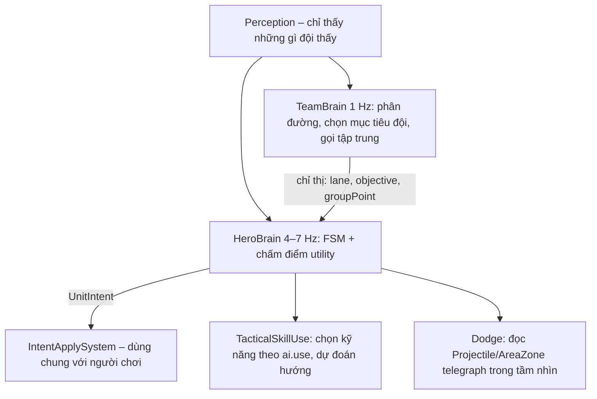

# 03 – Thiết kế gameplay

Mọi con số ở đây là **giá trị khởi điểm** và sẽ nằm trong `src/data/**`. Cân bằng lại bằng dữ liệu, không sửa logic.

## 1. Bản đồ "Thung Lũng Hoàng Hôn" (arena01)

### 1.1 Bố cục lưới 120 × 120 (gốc (0,0) ở góc trên-trái của lưới logic)

```
         x→ 0                                          119
  y=0       ┌──────────── TOP (hàng y≈8) ─────────────┬──────┐
            │ ╲                                       │  ĐỎ  │
            │   ╲ sông        Rừng ĐỎ-Trên        ╱   │      │
            │     ╲ [BOSS]                   ╱        └──────┤
            │       ╲                   ╱ MID                │
            │ Rừng    ╲            ╱                 Rừng    │
            │ XANH-     ╲     ╱                      ĐỎ-     │
            │ Trên        ╳  tâm (60,60)             Dưới    │
            │           ╱   ╲                                │
            │       ╱         ╲                              │
            │   ╱ MID           ╲ [RỒNG]                     │
            ├──────┐  Rừng XANH-Dưới ╲ sông                  │
            │ XANH │                    ╲                    │
            │      │                      ╲                  │
  y=119     └──────┴──────────── BOT (hàng y≈111) ───────────┘

  TOP = cột x≈8 (cạnh trái) nối hàng y≈8 (cạnh trên)
  BOT = hàng y≈111 (cạnh dưới) nối cột x≈111 (cạnh phải)
  Lãnh thổ Xanh: x < y (nửa dưới-trái đường sông) · Lãnh thổ Đỏ: x > y
```

- **Căn cứ Xanh** góc `(0,119)`, **căn cứ Đỏ** góc `(119,0)`. Khi chiếu isometric: Xanh nằm **bên trái**, Đỏ **bên phải**, Mid chạy **ngang** giữa màn hình, Top ở **phía trên**, Bot ở **phía dưới** (giống bố cục `IMG/hethongmap.jpg`).
- **Top lane:** dọc cột x≈8 rồi theo hàng y≈8. **Bot lane:** theo hàng y≈111 rồi dọc cột x≈111. **Mid lane:** đường chéo từ căn cứ Xanh tới căn cứ Đỏ. Bề rộng lane ~5 ô.
- **Sông:** đường chéo còn lại từ `(0,0)` tới `(119,119)`, rộng ~6 ô, đi được (làm chậm 0%), cắt Mid ở tâm.
- **Hang Boss:** cạnh sông nửa trên `(38,38)`. **Hang Rồng:** cạnh sông nửa dưới `(81,81)` (đối xứng tâm với Boss).
- **Rừng:** 4 khu giữa lane và sông, mỗi đội 2 khu (Trên/Dưới). Có tường đá/cây làm vật cản tạo lối đi hẹp và 4–6 bụi cỏ mỗi khu + bụi cỏ hai bên lane gần sông.
- **Vùng căn cứ an toàn:** đa giác quanh Bệ Hồi Sinh: hồi máu/năng lượng nhanh cho phe ta, tia bảo vệ gây sát thương lớn lên địch.
- **Đối xứng tâm:** chỉ mô tả nửa của Đội Xanh + 2 hang sông; Đội Đỏ sinh bằng `(x, y) → (119 − x, 119 − y)`. Có unit test kiểm tra mọi ô địa hình đối xứng.

### 1.2 Địa hình theo ô

| Mã | Loại | Đi được | Chặn đạn | Chặn tầm nhìn |
|----|------|---------|---------|---------------|
| 0 | Cỏ/đất rừng | ✔ | ✘ | ✘ |
| 1 | Đường lane (đá lát) | ✔ | ✘ | ✘ |
| 2 | Sông (nước nông) | ✔ | ✘ | ✘ |
| 3 | Bụi cỏ | ✔ | ✘ | ✔ (từ bên ngoài) |
| 4 | Tường/đá/cây lớn | ✘ | ✔ | ✔ |
| 5 | Nền căn cứ | ✔ | ✘ | ✘ |
| 6 | Ngoài biên | ✘ | ✔ | ✔ |

## 2. Chiến đấu

### 2.1 Công thức

| Mục | Công thức |
|-----|-----------|
| Chỉ số theo cấp | `stat(L) = base + growth × (L − 1)` rồi cộng modifier: `final = (base + Σflat) × (1 + Σpercent)` |
| Giáp hiệu dụng | `effArmor = max(0, armor × (1 − armorPenPct) − armorPenFlat)` (tương tự kháng phép) |
| Giảm sát thương | `dmg = raw × 100 / (100 + effArmor)`; sát thương chuẩn bỏ qua |
| Chí mạng | `rng < critChance` ⇒ `× critMultiplier` (mặc định 1.75), chỉ đánh thường |
| Tốc đánh | `attacksPerSec = base × (1 + bonusAS)`, giới hạn 2.5 |
| Hồi chiêu | `cd = base × 100 / (100 + abilityHaste)` |
| Hút máu | `heal = dmgSauGiảm × lifeSteal` (đánh thường), `× spellVamp` (kỹ năng) |
| Khiên | Hấp thụ trước máu, khiên hết hạn trước bị tiêu trước |
| Sát thương trụ lên tướng | `+heroRampPerHit` mỗi phát liên tiếp vào cùng một tướng (tối đa `maxRamp`), reset khi đổi mục tiêu |

### 2.2 Hiệu ứng trạng thái

| Hiệu ứng | Tác dụng | Cộng dồn |
|----------|---------|---------|
| Slow | Giảm tốc chạy theo % | Lấy mạnh nhất |
| Stun | Không di chuyển/đánh/dùng kỹ năng; ngắt vận chiêu & biến về | Làm mới thời gian |
| Knockback | Đẩy lùi cưỡng bức trong thời gian ngắn (dừng tại tường), ngắt vận chiêu | — |
| Silence | Không dùng kỹ năng (vẫn đánh thường & di chuyển) | Làm mới |
| Shield | Lượng máu ảo có thời hạn | Cộng dồn nhiều nguồn |
| Heal | Hồi máu tức thì (bị Poison giảm hiệu quả) | — |
| Burn | Sát thương phép mỗi 0.5 giây | Làm mới |
| Poison | Sát thương phép mỗi 1 giây + giảm 40% hồi máu nhận được | Cộng dồn tối đa 3 |

### 2.3 Đường ống dùng kỹ năng (đúng 10 bước của đặc tả)

1. Còn sống & không bị Stun/Silence → 2. Đủ năng lượng → 3. Hết hồi chiêu → 4. Trong tầm (unit/point; nếu ngoài tầm với kiểu `unit` thì đi tới rồi cast) → 5. Xác định mục tiêu theo `TargetFilter` → 6. Thực thi danh sách `EffectSpec` → 7. Tạo `DamageRequest` (DamageSystem tính) → 8. Cập nhật trạng thái (status, khiên, hồi máu) → 9. Phát SimEvent để Phaser hiển thị VFX/SFX → 10. Trừ năng lượng & bắt đầu cooldown.
Nếu thất bại ở bước 1–5 trả về `CastFailReason` (`dead`, `stunned`, `silenced`, `noMana`, `onCooldown`, `outOfRange`, `invalidTarget`) để HUD hiển thị thông báo ngắn.

## 3. Kinh tế & tiến cấp

| Nguồn | Vàng | KN |
|------|------|----|
| Thụ động | 3/giây (từ 0:30) | — |
| Lính cận chiến / đánh xa / công thành | 20 / 15 / 50 (kết liễu); 40% nếu ở gần mà không kết liễu | 30 / 25 / 60 chia đều cho tướng phe ta trong bán kính 900 |
| Quái nhỏ / lớn / Bùa | 25 / 60 / 90 | 40 / 90 / 120 |
| Rồng | 100 mỗi người trong đội | 200 cho người tham gia |
| Boss | 250 mỗi người còn sống | 400 cho người tham gia |
| Hạ gục tướng | 300 (+50 mỗi chuỗi từ 3, tối đa +200 tiền thưởng "khắc chế chuỗi") | 140 + 30 × chênh lệch cấp |
| Hỗ trợ | 150 chia đều | 50% KN hạ gục chia đều |
| Trụ Ngoài / Trong / Hộ Vệ | 150 cả đội + 100 kết liễu | 150 |

KN cần để lên cấp `L → L+1`: `100 + 80 × (L − 1)` (cấp 15 cần tổng 8.680 KN).

## 4. Luật nhắm mục tiêu

**Lính (đánh giá lại mỗi 0.5 giây hoặc khi mục tiêu chết):**
1. Tướng địch vừa tấn công tướng phe ta trong bán kính 500 (gọi trợ giúp).
2. Lính địch gần nhất.
3. Công trình địch gần nhất (đang có thể bị tấn công).
4. Tướng địch gần nhất.

**Trụ:**
1. Giữ mục tiêu hiện tại nếu còn hợp lệ, **trừ khi** có tướng địch gây sát thương lên tướng phe ta trong tầm trụ trong 2 giây qua ⇒ chuyển sang tướng đó.
2. Lính địch gần nhất (ưu tiên công thành → cận chiến → đánh xa khi bằng khoảng cách).
3. Tướng địch gần nhất.
4. Trụ chưa "dễ tổn thương" (`vulnerable = false`) thì miễn sát thương; giảm 66% sát thương khi không có lính địch trong 1000 đơn vị (chống đánh lén).

**Quái rừng:** chỉ phản ứng khi bị tấn công (`aggressive = false`) hoặc kẻ địch vào `detectRange` (`aggressive = true` – chỉ Boss phase 3). Cả trại cùng nổi giận. Rời `leashRange` 800 hoặc đuổi > 6 giây ⇒ **Return**: chạy về, hồi 10%/giây, miễn sát thương ⇒ **Idle** đầy máu.

## 5. Rừng, Rồng & Boss

| Quái | Loại | Xuất hiện / hồi sinh | Đặc điểm | Phần thưởng |
|------|------|----------------------|---------|-------------|
| Bầy Sói Đá (3 con) | Nhỏ | 0:45 / 75 giây | Đánh cận chiến | Vàng, KN |
| Nấm Độc Đầm Lầy (2 con) | Nhỏ | 0:45 / 75 giây | Đánh xa, gây Poison | Vàng, KN |
| Cự Thạch Quy | Lớn | 0:45 / 90 giây | Máu dày, đập đất làm chậm | Vàng, KN lớn |
| Thạch Linh Lam | Bùa Xanh | 1:00 / 120 giây | Bắn pha lê | Buff 90 giây: +20 abilityHaste, hồi 1% năng lượng tối đa/giây |
| Hỏa Mãng | Bùa Đỏ | 1:00 / 120 giây | Phun lửa (Burn) | Buff 90 giây: đánh thường gây Burn + Slow 10%, hồi máu khi ngoài giao tranh |
| Phong Long | Rồng | 3:00 / 240 giây | Phun gió đường thẳng, đập cánh hất lùi | Cả đội +6% AD & AP (cộng dồn 3, vĩnh viễn) |
| Titan Hư Không | Boss | 8:00 / 300 giây | 3 giai đoạn (dưới) | Buff "Ấn Hư Không" 150 giây cho cả đội còn sống: +20 AD, +35 AP, biến về 3 giây, lính trong 800 đơn vị +50% máu/sát thương & to hơn; +250 vàng/người |

**Titan Hư Không – giai đoạn:**

| Máu | Kỹ năng | Hành vi |
|-----|---------|---------|
| 100–60% | Đập Đất (vùng tròn trước mặt, cảnh báo 1.2 giây), Đánh thường | Đứng trong hang, đổi mục tiêu sang kẻ gây sát thương cao nhất |
| 60–30% | + Mưa Hư Không (3 vòng tròn ngẫu nhiên quanh mục tiêu, cảnh báo 1.0 giây, để lại vùng Poison) | Thông báo toàn bản đồ "Titan nổi giận" |
| < 30% | + Sóng Chấn Động (vòng tròn lan rộng từ thân, cảnh báo 1.5 giây, hất lùi) · Cuồng nộ +40% tốc đánh | Trở nên chủ động (`aggressive`) trong hang |

Mọi kỹ năng Boss đều tạo `AreaZone` có `telegraph = true` trước khi gây sát thương; AI tướng đọc vùng này để né.

## 6. Lính & trụ

| Đơn vị | Máu | Sát thương | Tầm | Ghi chú |
|-------|-----|-----------|-----|--------|
| Chiến Binh Thép (cận chiến) | 450 | 12 | 110 | +22 máu, +1 ST mỗi 90 giây |
| Pháp Sư Tập Sự (đánh xa) | 290 | 22 | 500 | Đạn phép |
| Xe Công Thành | 900 | 40 | 650 | Mỗi đợt thứ 3; nhận ít sát thương từ trụ |
| Trụ Ngoài | 3.000 | 160 | 750 | 1 phát/giây, +40% mỗi phát liên tiếp vào tướng (tối đa +120%) |
| Trụ Trong | 3.500 | 180 | 750 | |
| Trụ Hộ Vệ | 3.500 | 200 | 750 | |
| Nhà Chính | 4.500 | — | — | Không tấn công; hồi 5 máu/giây khi không bị đánh 8 giây |
| Bệ Hồi Sinh | bất tử | 1.000 sát thương chuẩn/giây lên địch | 900 | Hồi 10%/giây máu & năng lượng cho phe ta |

## 7. Danh sách 10 tướng nguyên bản (concept)

| # | Tướng | Vai trò | Vị trí | Nội tại | Q | W (phím F ở preset bàn phím) | E | R |
|---|-------|---------|--------|---------|---|---|---|---|
| 1 | **Thorne** – Kiếm Sĩ Gai Thép | Fighter | Top | Mỗi đòn đánh thứ 3 gây thêm sát thương | Chém vòng cung (nón, vật lý) | Giáp gai: **Shield** | Lướt tới (dash) + **Slow** | Đâm kiếm xuống đất: vùng tròn + **Stun** |
| 2 | **Brakka** – Chiến Binh Rìu Đá | Fighter | Jungle/Top | Hạ quái hồi máu | Ném rìu (đạn định hướng) + **Slow** | Gầm thét: tự tăng tốc đánh (buff) | Nhảy tới điểm + **Knockback** | Cuồng nộ: tăng AD, hút máu (buff lớn) |
| 3 | **Ignara** – Pháp Sư Hỏa Ngục | Mage | Mid | Kỹ năng gây **Burn** | Cầu lửa (đạn định hướng) | Vùng lửa tại điểm (zone tick) | Dịch chuyển ngắn (blink) | Thiên thạch: vùng lớn có trễ 1 giây, sát thương cao |
| 4 | **Selvane** – Pháp Sư Băng Tinh | Mage | Mid/Support | Trúng 3 lần **Slow** ⇒ **Stun** ngắn | Mũi băng xuyên (đạn xuyên) + **Slow** | Khiên băng cho đồng minh: **Shield** (chọn mục tiêu) | Vùng băng tại điểm + **Slow** | Bão tuyết quanh thân (zone theo người) |
| 5 | **Arwyn** – Cung Thủ Phong Vũ | Marksman | Carry | Đòn thứ 4 xuyên qua mục tiêu | Mưa tên (vùng tại điểm) | Tập trung: tăng tốc đánh (buff) | Nhảy lùi + **Slow** kẻ gần nhất | Mũi tên gió tầm xa (đạn định hướng dài) + **Stun** |
| 6 | **Quillon** – Xạ Thủ Đá Lửa | Marksman | Carry | Đòn chí mạng gây **Burn** | Bắn xuyên tuyến (line) | Đặt bẫy (zone) gây **Stun** khi địch dẫm | Lăn né (dash ngắn) | Pháo kích: 3 vùng nổ liên tiếp |
| 7 | **Gorvak** – Người Khổng Lồ Đá | Tank | Top/Jungle | Máu < 30%: giảm 15% sát thương nhận | Đập đất vùng tròn quanh thân + **Slow** | Da đá: **Shield** + giáp | Húc (dash) + **Knockback** | Động đất: vùng lớn quanh thân, trễ 0.6 giây + **Stun** |
| 8 | **Haldor** – Hiệp Sĩ Khiên Tháp | Tank | Support | Đồng minh gần +10 giáp (aura) | Ném khiên chọn mục tiêu + **Stun** | Che chắn đồng minh: **Shield** (chọn mục tiêu) | Đẩy khiên tới (nón) + **Knockback** | Thánh vực: vùng hồi máu đồng minh + giảm sát thương |
| 9 | **Zerith** – Sát Thủ Bóng Đêm | Assassin | Jungle/Mid | Đòn đầu tiên khi ra khỏi bụi cỏ gây thêm sát thương | Phi dao (đạn) + **Poison** | Lướt bóng (dash xuyên) | Phong ấn: chọn mục tiêu + **Silence** | Ám sát: dịch chuyển ra sau mục tiêu, sát thương tăng theo máu đã mất |
| 10 | **Elowen** – Tư Tế Suối Nguồn | Support | Support | Hồi máu nhỏ cho đồng minh quanh mình mỗi 5 giây | Cầu ánh sáng (đạn) + **Slow** | Hồi máu đồng minh: **Heal** (chọn mục tiêu) | Ban phước: **Shield** + tốc chạy cho đồng minh | Vòng thánh quang: hồi máu lớn diện rộng + xóa Slow |

Phủ đủ mọi loại kỹ năng của đặc tả: định hướng, chọn mục tiêu, diện rộng, khống chế, hồi máu, lá chắn; và đủ 8 hiệu ứng: Slow, Stun, Knockback, Silence, Shield, Heal, Burn, Poison.

**Mở khóa mặc định (6):** Thorne, Ignara, Arwyn, Gorvak, Zerith, Elowen. **Mở bằng Điểm Vinh Danh (4):** Brakka, Selvane, Quillon, Haldor.

**Draft AI:** sau khi người chơi chọn tướng + vị trí, `DraftService` (seed) chia 9 tướng còn lại sao cho mỗi đội có đủ Top, Jungle, Mid, Carry, Support theo `positions` của tướng.

## 8. Danh sách trang bị khởi điểm (22)

| Nhóm | Cơ bản | Nâng cấp / Huyền thoại |
|------|--------|------------------------|
| Công kích | Kiếm Sắt (+AD), Dao Găm Nhanh (+tốc đánh) | **Đại Đao Huyết Nguyệt** (AD + hút máu), **Cung Phong Vũ** (tốc đánh + chí mạng), **Lưỡi Hái Bóng Đêm** (AD + xuyên giáp) |
| Phép thuật | Ngọc Phép (+AP), Bình Ngọc Lam (+năng lượng) | **Trượng Hỏa Ngục** (AP + Burn khi kỹ năng trúng), **Thần Thư Băng Giá** (AP + Slow khi kỹ năng trúng), **Mũ Tinh Tú** (AP +% ) |
| Phòng thủ | Giáp Da (+giáp), Áo Choàng Sương (+kháng phép), Đá Sinh Mệnh (+máu) | **Giáp Thạch Long** (giáp + máu + phản sát thương), **Khiên Ánh Trăng** (kháng phép + khiên khi máu thấp) |
| Tốc độ | Giày Vải (+tốc chạy, nhóm `boots`) | **Giày Phong Hành** (tốc chạy + tốc đánh), **Giày Hiền Triết** (tốc chạy + abilityHaste) |
| Hỗ trợ | — | **Ấn Hộ Vệ** (aura giáp cho đồng minh), **Chuông Bình Minh** (tăng hồi máu/khiên cho đồng minh) |
| Hồi phục | Bình Máu (tiêu hao, cộng dồn 5), Bùa Hồi Phục (+hồi máu) | **Áo Rêu Cổ Thụ** (máu + hồi máu % theo thời gian) |

Gợi ý theo vai trò: lấy từ `ItemDefinition.recommendedFor` + `HeroDefinition.ai.buildPath` (cùng nguồn cho UI gợi ý và AI mua đồ).

## 9. AI 5v5

### 9.1 Kiến trúc AI 3 tầng



- **Perception** chỉ trả về: đồng minh, kẻ địch đang **trong tầm nhìn của đội**, công trình (luôn biết), quái trong tầm nhìn, thông tin công khai (thời gian, tỉ số, giờ xuất hiện Rồng/Boss), và **ký ức** "thấy lần cuối ở đâu, lúc nào" (phai sau 5 giây). Lint rule: thư mục `ai/` không được import `EntityRegistry` trực tiếp.
- **Tầm nhìn:** tướng 1.200, lính 800, trụ 1.000. Đứng trong bụi cỏ chỉ bị thấy bởi kẻ cùng bụi hoặc trong 150 đơn vị. Tấn công từ trong bụi làm lộ diện 1.5 giây.

### 9.2 Trạng thái HeroBrain

| Trạng thái | Vào khi | Hành động | Thoát khi |
|-----------|---------|----------|-----------|
| Idle | Vừa hồi sinh / không có chỉ thị | Đợi chỉ thị TeamBrain, mua đồ nếu ở căn cứ | Có chỉ thị |
| Move | Có đích (lane, trại, điểm tập trung) | A* tới đích | Tới nơi / có sự kiện ưu tiên cao hơn |
| Farming | Ở lane có lính địch | Đứng sau lính ta, kết liễu lính khi `hp < dmg` (tỉ lệ thành công theo độ khó), tránh tầm trụ địch khi không có lính ta đỡ | Lane sạch / địch xuất hiện |
| Jungle | Vị trí Jungle, trại sẵn sàng | Đi theo lộ trình trại tối ưu khoảng cách | Hết trại / có gank |
| Attack | Có mục tiêu hợp lệ & lợi thế | Đánh thường + combo kỹ năng | Mục tiêu chết/mất dấu / bất lợi |
| Chase | Mục tiêu bỏ chạy, máu thấp | Đuổi tối đa 4 giây, không lao vào trụ địch | Hết thời gian / vào tầm trụ |
| Retreat | `hp% < ngưỡng` hoặc chênh lệch lực lượng âm | Lùi về trụ ta, dùng kỹ năng thoát; quá thấp ⇒ biến về | An toàn & hồi máu |
| Support | Vai trò Support/Tank có đồng minh bị đánh | Dùng hồi máu/khiên/khống chế bảo vệ đồng minh | Đồng minh an toàn |
| TeamFight | ≥ 3 tướng mỗi bên trong 1.200 | Tank/Fighter mở giao tranh, Marksman/Mage giữ khoảng cách đánh mục tiêu dễ hạ, Assassin nhắm tướng máu giấy | Giao tranh kết thúc |
| PushTower | Có lính ta đỡ đòn trụ | Đánh trụ khi trụ đang nhắm lính | Lính ta chết / trụ đổi mục tiêu sang mình |
| DefendBase | Công trình ta bị tấn công & đủ gần | Về thủ, ưu tiên dọn lính | Mối đe dọa hết |

Chuyển trạng thái bằng **chấm điểm utility** mỗi lần suy nghĩ (ví dụ: `retreatScore = (1 − hp%) × w1 + enemyPower/allyPower × w2 + underEnemyTower × w3`), chọn trạng thái điểm cao nhất có **độ trễ chuyển** (hysteresis) để tránh giật qua lại.

### 9.3 Hành vi theo vai trò

| Vai trò | Khác biệt |
|--------|-----------|
| Fighter | Hay tách đẩy đường; mở giao tranh khi máu > 60% |
| Tank | Đi đầu, dùng khống chế đầu tiên, bảo vệ Marksman |
| Mage | Gây sát thương từ xa bằng kỹ năng định hướng, rút lui sớm hơn |
| Marksman | Giữ khoảng cách bằng tầm đánh, đánh mục tiêu gần nhất an toàn, farm ưu tiên |
| Assassin | Đi rừng, gank đường có địch < 50% máu, nhắm Mage/Marksman |
| Support | Đi cùng Marksman, ưu tiên hồi máu/khiên, đứng giữa Marksman và địch |

### 9.4 Độ khó

| Tham số | Easy | Normal | Hard |
|--------|------|--------|------|
| Tần suất suy nghĩ HeroBrain | 4 Hz | 5 Hz | 7 Hz |
| Thời gian phản ứng | 600 ms | 350 ms | 180 ms |
| Dự đoán hướng skillshot | Không, lệch ±20° | 50%, lệch ±10° | 90%, lệch ±4° |
| Xác suất né kỹ năng thấy được | 10% | 40% | 75% |
| Ngưỡng rút lui (%HP) | 20% | 30% | 35% + đánh giá lực lượng |
| Tỉ lệ kết liễu lính thành công | 50% | 75% | 95% |
| Phối hợp đội | Không gọi tập trung | Tập trung sau 10:00, tranh Rồng | Chủ động Rồng/Boss, rút khi thua người |
| Cộng thêm tài nguyên | Không | Không | Không (AI không gian lận) |

### 9.5 Chống kẹt & gỡ lỗi AI

- Không tiến triển 2 giây (khoảng cách tới đích không giảm) ⇒ tìm đường lại; 3 lần ⇒ đổi trạng thái về Move-to-lane.
- Debug overlay (phím F2 ở chế độ dev): hiển thị trạng thái, mục tiêu, đường đi của từng AI.
- Test headless: 20 seed × 3 độ khó, ghi số liệu thắng/thua, thời lượng, KDA → phát hiện AI kẹt (tướng không di chuyển > 30 giây).
