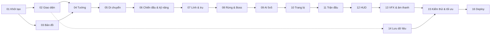

# 04 – Kế hoạch phát triển & tiêu chí nghiệm thu

## 1. Tổng quan lộ trình

Giữ đúng số thứ tự PROMPT 01–16 của đặc tả, nhưng **làm rõ phạm vi từng giai đoạn** để không phải dùng dữ liệu giả hoặc làm nút "chết" (xem mâu thuẫn #5 trong `00-phan-tich-yeu-cau.md`).



### Các mốc

| Mốc | Sau GĐ | Người chơi làm được gì |
|-----|--------|------------------------|
| **M1 – Đi dạo đấu trường** | 05 | Chọn tướng, vào bản đồ isometric, điều khiển tướng đi khắp bản đồ, va chạm tường, camera, minimap |
| **M2 – Đẩy đường** | 07 | Đánh thường/kỹ năng lên lính, trụ; lính tự đi đường; phá chuỗi trụ và Nhà Chính ⇒ trận kết thúc, có màn kết quả cơ bản |
| **M3 – Trận 5v5 chơi được** | 09 | 9 AI tham gia trận, có rừng & Boss; một trận đầy đủ có thể kết thúc |
| **M4 – Trải nghiệm hoàn chỉnh** | 12 | Trang bị, thống kê trận, HUD đầy đủ |
| **M5 – Phát hành** | 16 | Hiệu ứng, âm thanh, lưu dữ liệu, tối ưu, deploy tĩnh |

### Ước lượng khối lượng (tương đối)

| GĐ | 01 | 02 | 03 | 04 | 05 | 06 | 07 | 08 | 09 | 10 | 11 | 12 | 13 | 14 | 15 | 16 |
|----|----|----|----|----|----|----|----|----|----|----|----|----|----|----|----|----|
| Khối lượng | S | M | L | M | M | XL | L | L | XL | M | M | M | L | S | L | S |

S ≈ 1 phiên làm việc · M ≈ 2 · L ≈ 3–4 · XL ≈ 5+ (một "phiên" = một lượt AI code + build + kiểm thử + review).

## 2. Tiêu chuẩn hoàn thành chung (áp dụng MỌI giai đoạn)

- [ ] `npm run typecheck` – 0 lỗi.
- [ ] `npm run lint` – 0 lỗi (bao gồm luật ranh giới import).
- [ ] `npm run test` – toàn bộ test pass; test mới cho logic thêm vào trong `shared`, `data`, `game/sim`, `storage`.
- [ ] `npm run build` thành công; `npm run preview` mở được và không lỗi console.
- [ ] `npm run check:placeholders` – không có `TODO`, `FIXME`, hàm rỗng đánh dấu, nút không gắn hành động.
- [ ] Mọi nút xuất hiện trên giao diện đều có tác dụng thật; chức năng chưa có thì **không hiển thị** (không dùng nút "Coming soon").
- [ ] Kiểm tra thủ công theo `docs/qa/phase-XX.md` (tạo trong giai đoạn đó) và ghi kết quả thực tế.
- [ ] Review chất lượng (PROMPT KIỂM TRA CHẤT LƯỢNG), sửa lỗi Critical/High.
- [ ] Cập nhật bảng tiến độ `docs/README.md` + liệt kê phần chưa hoàn thành.

## 3. Chi tiết từng giai đoạn

### GĐ 01 – Khởi tạo dự án
**Mục tiêu:** Khung dự án chạy được, đúng kiến trúc, chưa có gameplay.
**Phạm vi:** Vite + React + TS strict; Phaser; Tailwind; Zustand; Vitest; ESLint (luật ranh giới import) + Prettier; alias `@/`; cấu trúc thư mục ở `01-kien-truc-tong-the.md`; `MainLayout`; `MainMenu` (logo SVG nguyên bản, theme xanh đậm–tím–vàng kim); `GameHost` + `GameContainer` + `BootScene` tối giản (nền + chữ "Arena Legends" vẽ bằng Phaser) để kiểm chứng vòng đời; `appFlowStore`; kiểu nền tảng trong `src/shared/types`; `scripts/check-placeholders`.
**Lưu ý:** thư mục gốc đã có `IMG/`, `docs/`, `cautruc_prompt.md` – khởi tạo Vite thủ công/bằng thư mục tạm rồi chuyển vào, **không xóa** các file hiện có.

**Tiêu chí nghiệm thu:**
- [ ] `npm install`, `npm run dev`, `npm run build`, `npm run preview` đều chạy.
- [ ] `tsconfig` bật `strict` + `noUncheckedIndexedAccess`; một import `phaser` thử trong `src/game/sim` làm `npm run lint` báo lỗi (sau đó xóa).
- [ ] Main Menu hiển thị logo nguyên bản, responsive từ 375px tới 2560px.
- [ ] Nút Play mở màn trận thử nghiệm: **đúng 1** `<canvas>`; quay về Menu ⇒ 0 canvas; lặp 10 lần không tăng số canvas, không lỗi console. Trong React StrictMode (dev) vẫn chỉ 1 canvas.
- [ ] Phaser nằm ở chunk riêng; JS ban đầu (không gồm Phaser) ≤ 250 KB gzip.
- [ ] Font tự host, không có request mạng ra ngoài domain (kiểm tra tab Network).

### GĐ 02 – Thiết kế giao diện
**Mục tiêu:** Các màn hình React có thật và chạy được với dữ liệu thật đã tồn tại.
**Phạm vi làm thật:** Main Menu (Play, độ khó, Danh sách tướng, Cửa hàng mở khóa, Hồ sơ, Cài đặt), Hero Selection, Hero Catalog, Hero Shop (mở khóa bằng Điểm Vinh Danh), Settings (âm thanh/đồ họa/điều khiển – lưu thật), Profile (tên người chơi, thống kê – ban đầu bằng 0 thật), Loading Overlay (tiến độ thật từ Phaser loader), Pause Menu (Tiếp tục / Cài đặt / Thoát – hoạt động thật trên màn trận thử). Dữ liệu **metadata** 10 tướng (tên, vai trò, mô tả, tên + mô tả kỹ năng, portrait placeholder) tạo trong `src/data/heroes` – chính dữ liệu này được GĐ 04 bổ sung chỉ số.
**Kéo lên sớm:** lõi `storage/` (`safeStorage`, `SaveManager` có `version`) phục vụ Settings & Profile; GĐ 14 mở rộng.
**Dựng component, chưa gắn vào trận:** Battle HUD widgets, Item Shop, Scoreboard, Match Result – component nhận props có kiểu (`HudSnapshot`…), kiểm thử bằng Testing Library với fixture **trong file test**. Gắn vào màn trận dần ở GĐ 04–12 khi dữ liệu thật có.

**Tiêu chí nghiệm thu:**
- [ ] Đi được toàn bộ luồng màn hình trong `01-kien-truc-tong-the.md` §2 (trừ phần trận thật).
- [ ] Không chọn được tướng chưa mở khóa (hiển thị khóa + giá). Mở khóa ở Hero Shop trừ Điểm Vinh Danh và lưu sau khi tải lại trang.
- [ ] Đổi cài đặt ⇒ tải lại trang vẫn giữ.
- [ ] Tất cả nút có hover/focus/disabled rõ ràng; điều hướng bằng bàn phím được ở menu.
- [ ] Component HUD/Shop/Scoreboard/Result có test render với fixture; **không** xuất hiện trên màn hình sản phẩm khi chưa có dữ liệu thật.

### GĐ 03 – Bản đồ isometric
**Phạm vi:** `MapConfig` arena01 (nửa Xanh + 2 hang sông) + `mirror.ts`; `MapBuilder` → `NavGrid`, vùng (base, bụi, sông), vị trí trụ/trại/lane; `IsoProjector`; `MapRenderer` (Phaser isometric Tilemap + trang trí); `CameraController` (camera tự do: kéo chuột/phím mũi tên/cuộn mép, giới hạn biên); `MinimapBaker` + gắn widget Minimap (click để di chuyển camera); `DebugOverlay` (F1: lưới đi được, F3: FPS).

**Tiêu chí nghiệm thu:**
- [ ] Bản đồ hiển thị đủ: 2 căn cứ, 3 lane, sông, 4 khu rừng, bụi cỏ, vật cản, vị trí 22 công trình, 10 trại, hang Rồng, hang Boss (đánh dấu bằng placeholder art).
- [ ] Unit test: mọi ô `(x,y)` có cùng loại địa hình với `(119−x, 119−y)`; mọi công trình/trại phía Đỏ là ảnh đối xứng của phía Xanh.
- [ ] Unit test round-trip `screenToWorld(worldToScreen(p))` sai số < 0.001.
- [ ] Unit test: tồn tại đường đi A* giữa 2 Bệ Hồi Sinh qua cả 3 lane; mọi trại quái có đường đi tới.
- [ ] Camera không ra ngoài biên bản đồ; click minimap đưa camera tới đúng vị trí.
- [ ] ≥ 60 FPS khi pan camera toàn bản đồ trên máy chuẩn; số tile được vẽ mỗi frame chỉ là phần trong camera.

### GĐ 04 – Hệ thống tướng
**Phạm vi:** `StatBlock` đầy đủ cho 10 tướng + growth; `Unit`, `Hero`, `StatSheet`, `Health`, `ResourcePool`, `Experience`; `HeroFactory`; `MatchSimulation.create(setup)` đặt 10 tướng tại Bệ Hồi Sinh; `DraftService` (chia 9 tướng AI theo vị trí); `RenderSync` + `HeroView` (animation idle/move/attack/death – placeholder procedural, 4 hướng nhìn); thanh máu trên đầu (pool); `data/validate.ts`; gắn PlayerPanel (máu/năng lượng/cấp) của HUD.
**Kỹ năng ở GĐ này:** chỉ dữ liệu định nghĩa (`SkillDefinition` đầy đủ trường), chưa thực thi – thực thi ở GĐ 06. Không hiển thị nút kỹ năng trên HUD cho tới GĐ 06.

**Tiêu chí nghiệm thu:**
- [ ] Chọn tướng ⇒ vào trận thấy 10 tướng đúng đội, đúng tướng đã chọn/draft, không trùng.
- [ ] Unit test tăng chỉ số theo cấp 1→15 khớp công thức; lên cấp giữ tỉ lệ máu hiện tại.
- [ ] Unit test `validate.ts`: dữ liệu hiện tại hợp lệ; dữ liệu hỏng (id trùng, thiếu skill, mảng cooldown sai độ dài) bị phát hiện.
- [ ] Thêm tướng thứ 11 bằng dữ liệu (trong test) không cần sửa logic.
- [ ] Trạng thái sống/chết hoạt động (gây chết bằng lệnh debug dev-only, không có trong build production) và animation chết chạy.

### GĐ 05 – Điều khiển & di chuyển
**Phạm vi:** `InputAction` + `defaultBindings` (preset Bàn phím & Chuột); `PhaserInputAdapter` → `UnitIntent`; `IntentApplySystem`; `MovementSystem` (gia tốc, 8 hướng, click-to-move bằng A* + làm mượt đường); `CollisionSystem` (tường lưới + đẩy tách unit + biên bản đồ); `SpatialHash`; camera bám tướng (Y bật/tắt); UI đổi phím trong Settings (phát hiện trùng, cấm phím hệ thống, khôi phục mặc định); fixed timestep + nội suy.

**Tiêu chí nghiệm thu:**
- [ ] WASD di chuyển mượt, đi chéo không nhanh hơn đi thẳng; click-to-move đi vòng qua vật cản.
- [ ] Test headless: đẩy tướng vào tường 10 giây theo 16 hướng ⇒ không bao giờ ở trong ô tường hoặc ngoài bản đồ.
- [ ] Hướng nhìn/animation đổi theo hướng di chuyển.
- [ ] Đổi phím trong Settings có hiệu lực ngay trong trận, lưu sau khi tải lại.
- [ ] Mở Pause/Settings thì phím di chuyển không tác dụng; gõ phím trong ô nhập tên không làm tướng chạy.
- [ ] Tab ẩn 30 giây rồi quay lại: game tự Pause, không "nhảy cóc".
- [ ] **Mốc M1** đạt.

### GĐ 06 – Chiến đấu & kỹ năng
**Phạm vi:** `CombatSystem` (đánh theo mục tiêu, đánh theo hướng, windup, tốc đánh), `Projectile` + `ProjectileSystem` (va chạm quét), `AreaZone`, `SkillSystem` (đường ống 10 bước), `SkillExecutor` + toàn bộ `EffectSpec`, `StatusEffectSystem` (8 hiệu ứng), `DamageSystem` + `DamageCalculator`, `RegenSystem`, `DeathSystem`, `RespawnSystem`, hook `custom/` cho nội tại đặc biệt; khóa mục tiêu (Space); chỉ báo tầm/hướng kỹ năng; số sát thương bay lên (pool); AbilityBar trên HUD (cooldown overlay, năng lượng không đủ, nâng cấp kỹ năng bằng điểm).

**Tiêu chí nghiệm thu:**
- [ ] Đủ 10 tướng × (nội tại + Q/W/E/R) thực thi đúng mô tả trong `03-thiet-ke-gameplay.md` §7.
- [ ] Unit test `DamageCalculator`: giáp/kháng phép/xuyên giáp/chí mạng/sát thương chuẩn với bảng giá trị mong đợi.
- [ ] Unit test từng hiệu ứng: Slow (lấy mạnh nhất), Stun (chặn di chuyển/đánh/kỹ năng), Silence (chỉ chặn kỹ năng), Knockback (dừng ở tường), Shield (hấp thụ trước, hết hạn), Heal (bị Poison giảm 40%), Burn/Poison tick đúng.
- [ ] Unit test đường ống cast: mỗi điều kiện thất bại trả đúng `CastFailReason`, không trừ năng lượng/không bắt đầu cooldown khi thất bại.
- [ ] Đạn tốc độ cao không xuyên mục tiêu nhỏ (test quét).
- [ ] Không có giá trị sát thương nào viết trực tiếp trong system/component (grep số liệu trong `systems/` chỉ còn hằng số kỹ thuật).
- [ ] Hạ tướng địch (đang đứng yên vì chưa có AI) ⇒ chết, hồi sinh sau `5 + 2.5 × cấp` giây tại Bệ.

### GĐ 07 – Lính & trụ
**Phạm vi:** `MinionDefinition` ×3, `WaveSpawnSystem`, `LanePaths`, `MinionBrain` (luật ưu tiên), pool lính; `StructureDefinition`, `Tower`, `Core`, `Fountain`, `TowerSystem`, `StructureSystem` (chuỗi phá trụ, chống đánh lén), Bệ hồi máu/tia bảo vệ; `EconomySystem` + `ExperienceSystem` (vàng/KN từ lính & trụ, vàng thụ động); `MatchSystem` tối thiểu: Nhà Chính bị phá ⇒ `matchEnded` ⇒ màn Result cơ bản (thắng/thua + thời gian); hiển thị vàng trên HUD.

**Tiêu chí nghiệm thu:**
- [ ] Đợt lính đầu ở 0:30, mỗi 30 giây, công thành mỗi đợt thứ 3; lính đi đúng 3 lane và đánh nhau ở giữa.
- [ ] Unit test luật nhắm mục tiêu của trụ (4 tình huống trong `03-thiet-ke-gameplay.md` §4) và của lính.
- [ ] Trụ chưa tới lượt thì miễn sát thương (hiển thị biểu tượng khiên); phá đúng thứ tự mới vào được Nhà Chính.
- [ ] Test headless "chỉ có lính": hai bên cân bằng ⇒ sau 10 phút không có Nhà Chính nào bị phá; cấu hình test chỉ đội Xanh sinh lính ⇒ Nhà Chính Đỏ bị phá và `matchEnded(winner='blue')`.
- [ ] Kết liễu lính nhận đúng vàng; KN chia đúng bán kính.
- [ ] Người chơi tự phá Nhà Chính Đỏ ⇒ màn Victory; về Menu ⇒ chơi lại không cần tải trang. **Mốc M2** đạt.

### GĐ 08 – Rừng & Boss
**Phạm vi:** `MonsterDefinition` ×7 + `BossDefinition`; `JungleSystem` (lịch xuất hiện), `MonsterBrain` FSM 7 trạng thái, gọi bầy, leash; `BossBrain` + 3 giai đoạn + kỹ năng có `telegraph`; `TelegraphRenderer`; `BuffRewardSystem` (Bùa Xanh/Đỏ chuyển chủ khi người giữ bị hạ, Rồng cộng dồn, Ấn Hư Không cường hóa lính); BuffBar trên HUD; thông báo Rồng/Boss xuất hiện/bị hạ.

**Tiêu chí nghiệm thu:**
- [ ] Unit test chuyển trạng thái quái: Idle→Detect (khi bị đánh)→Chase→Attack→Return (ra ngoài leash/quá 6 giây)→Idle đầy máu; Dead→Respawn đúng thời gian.
- [ ] Boss đổi giai đoạn đúng ngưỡng 60%/30%, mỗi kỹ năng Boss có cảnh báo hiển thị ≥ 1.0 giây trước khi gây sát thương.
- [ ] Hạ Bùa Xanh/Đỏ, Rồng, Boss ⇒ buff hiển thị trên HUD và **chỉ số thay đổi thật** (kiểm tra trong panel chỉ số).
- [ ] Lính được cường hóa khi đội có Ấn Hư Không (to hơn, máu/sát thương tăng).

### GĐ 09 – AI 5v5
**Phạm vi:** `VisionSystem` + `Perception` (bụi cỏ, ký ức), `TeamBrain`, `HeroBrain` 11 trạng thái + chấm điểm utility, hồ sơ vai trò, sử dụng kỹ năng theo `ai.use` + dự đoán hướng, né kỹ năng (đạn/telegraph), rút lui/biến về, 3 độ khó, chống kẹt, debug overlay AI; `runHeadlessMatch`.

**Tiêu chí nghiệm thu:**
- [ ] 9 AI ra đúng vị trí (Top/Jungle/Mid/Carry+Support), farm, dùng kỹ năng, giao tranh, đẩy trụ, rút lui, thủ nhà, tranh Rồng/Boss – quan sát được bằng debug overlay.
- [ ] Unit test Perception: tướng đứng trong bụi (không có địch cùng bụi) **không** có trong kết quả truy vấn của đội địch; lint chặn `ai/` import `EntityRegistry`.
- [ ] Headless: 20 seed × Normal ⇒ ≥ 18 trận kết thúc có người thắng trong ≤ 35 phút game; không tướng AI nào đứng yên > 30 giây khi còn sống.
- [ ] Headless: đội Hard vs đội Easy thắng ≥ 70% trong 20 seed (chứng minh độ khó có tác dụng).
- [ ] Thời gian AI trung bình ≤ 2 ms/frame trên máy chuẩn (đo bằng DebugOverlay).
- [ ] Người chơi chơi trọn một trận 5v5 từ đầu đến cuối. **Mốc M3** đạt.

### GĐ 10 – Trang bị & cửa hàng
**Phạm vi:** 22 `ItemDefinition`; `Inventory`, `ShopSystem` (mua/bán/ghép, `uniqueGroup`, chỉ mua ở căn cứ hoặc khi chết, giới hạn 6 ô), nội tại trang bị, trang bị chủ động (nếu có) & tiêu hao; báo giá trong snapshot; gắn Item Shop overlay (lọc nhóm, gợi ý theo vai trò, panel chi tiết, cây ghép) + ItemBar trên HUD; AI mua đồ theo `buildPath` khi về nhà.

**Tiêu chí nghiệm thu:**
- [ ] Unit test: giá ghép = tổng − giá thành phần đang có; bán hoàn 60%; không mua khi thiếu vàng/hết ô/ngoài căn cứ (trả lý do đúng); giày thứ 2 bị chặn.
- [ ] Mua xong chỉ số trên HUD thay đổi đúng; nội tại (Burn khi kỹ năng trúng, khiên khi máu thấp, aura…) hoạt động.
- [ ] Nút Mua bị vô hiệu kèm lý do khi không đủ điều kiện; phím tắt mở/đóng Shop.
- [ ] AI có trang bị tăng dần theo thời gian (kiểm tra scoreboard).

### GĐ 11 – Hệ thống trận đấu
**Phạm vi:** `MatchSystem` đầy đủ 7 trạng thái, Pause thật (dừng sim + VFX), `MatchStatsTracker`, chuỗi hạ gục/chiến công đầu, Scoreboard (giữ Tab), màn Victory/Defeat có hiệu ứng nổ Nhà Chính, Match Result đầy đủ (KDA, tổng sát thương, vàng, lính, trụ, thời gian, cho cả 10 tướng), cộng Điểm Vinh Danh, "Chơi lại".

**Tiêu chí nghiệm thu:**
- [ ] Số liệu trên màn kết quả khớp với log sự kiện (unit test tracker với chuỗi sự kiện mẫu).
- [ ] Pause giữ nguyên trạng thái: hồi chiêu, đếm giờ, Boss timer không chạy khi Pause.
- [ ] 3 trận liên tiếp không tải lại trang: không lỗi, số canvas luôn ≤ 1, heap không tăng dần (đo sơ bộ).
- [ ] Thoát trận giữa chừng từ Pause ⇒ về Menu, không ghi kết quả thắng.

### GĐ 12 – Battle HUD hoàn chỉnh
**Phạm vi:** đủ 14 thành phần của PROMPT 12; animation (lên cấp, kỹ năng sẵn sàng), tooltip kỹ năng với **số thật** tính từ chỉ số hiện tại (`shared/rules/scaling`), thông báo hạ gục/Boss/phá trụ, màn đen trắng + đếm ngược khi chết, thanh biến về, responsive 1280×720 → 2560×1440.

**Tiêu chí nghiệm thu:**
- [ ] Mọi giá trị HUD lấy từ `hudStore` (không hằng số hiển thị).
- [ ] React Profiler: HUD commit ≤ 12 lần/giây trung bình khi giao tranh; Minimap vẽ bằng canvas, không re-render React.
- [ ] Tooltip Q của Ignara thay đổi khi mua trang bị AP.
- [ ] Bố cục không chồng lấn ở 1280×720, 1920×1080, 2560×1440.
- [ ] **Mốc M4** đạt.

### GĐ 13 – Hiệu ứng & âm thanh
**Phạm vi:** `VfxDirector` (pool particle + sprite VFX) cho 13 loại sự kiện; rung màn hình (tắt được); `AudioDirector` (nhạc menu/trận, SFX, âm lượng tổng/nhạc/SFX, tắt tiếng, mở khóa audio sau thao tác đầu tiên); tải asset theo nhóm (menu / trận / theo tướng có trong trận); thay placeholder bằng atlas nguyên bản khi có.

**Tiêu chí nghiệm thu:**
- [ ] Mỗi sự kiện trong danh sách PROMPT 13 có VFX và (nếu có trong danh sách âm thanh) SFX.
- [ ] Giới hạn particle theo chất lượng (thấp/trung bình/cao) được tôn trọng (đếm trong DebugOverlay).
- [ ] Đổi âm lượng có hiệu lực ngay; tắt tiếng tắt hoàn toàn.
- [ ] Menu không tải asset của trận (tab Network).

### GĐ 14 – Lưu dữ liệu client
**Phạm vi:** hoàn thiện `SaveDataV1` (tên, mở khóa, cài đặt, âm lượng, phím, lịch sử 30 trận, thống kê, thành tích), validators, `migrations` (v0 – định dạng GĐ 02 – → v1), fallback bộ nhớ khi localStorage lỗi, xử lý đầy dung lượng, nút "Xóa dữ liệu" có xác nhận trong Settings, hệ thống thành tích.

**Tiêu chí nghiệm thu:**
- [ ] Unit test: dữ liệu hỏng JSON / sai kiểu / version tương lai ⇒ dùng mặc định + sao lưu bản hỏng vào khóa `arena-legends:backup`; migration v0→v1 giữ nguyên cài đặt.
- [ ] Giả lập `localStorage.setItem` ném lỗi (quota/private mode) ⇒ game vẫn chạy, thông báo "Không thể lưu dữ liệu".
- [ ] Không ghi localStorage trong lúc chiến đấu trừ khi đổi cài đặt (kiểm tra bằng spy).

### GĐ 15 – Kiểm thử & tối ưu
**Phạm vi:** chạy toàn bộ checklist 16 mục của PROMPT 15 trên thực tế; object pooling (lính, đạn, VFX, số sát thương, thanh máu); texture atlas; giới hạn particle; AI tick so le; code splitting; đo và sửa rò rỉ.

**Tiêu chí nghiệm thu:**
- [ ] Đạt NFR-01 (60 FPS mục tiêu, ≥ 45 FPS giao tranh 10 tướng) trên máy chuẩn – ghi số đo vào `docs/qa/phase-15.md`.
- [ ] Đạt NFR-05: 5 trận liên tiếp, heap chênh ≤ 10%, ≤ 1 canvas, số listener của `GameHost` trở về 0 sau khi hủy.
- [ ] Không tạo object mới trong vòng lặp nóng (kiểm tra bằng Allocation profiler: không có GC lớn đều đặn trong giao tranh).
- [ ] Bộ test headless (NFR-07) chạy trong CI script `npm run test:headless`.

### GĐ 16 – Build & deploy
**Phạm vi:** `VITE_BASE`; đường dẫn asset dùng `import.meta.env.BASE_URL`; workflow GitHub Pages (GitHub Actions), `netlify.toml`, `vercel.json` (static); tối ưu ảnh (WebP), kiểm tra không có file từ `IMG/` trong `dist`; README (giới thiệu, chạy local, build, deploy 3 nền tảng, điều khiển, credits).

**Tiêu chí nghiệm thu:**
- [ ] `npm run build` + `npm run preview -- --base=/arena-legends/` chạy đủ luồng một trận.
- [ ] Bản deploy thật (ít nhất 1 nền tảng) chơi được một trận trọn vẹn, refresh ở bất kỳ màn nào không lỗi 404.
- [ ] Hoạt động offline sau khi tải trang (NFR-09).
- [ ] Đạt toàn bộ "TIÊU CHÍ NGHIỆM THU CUỐI CÙNG" trong đặc tả. **Mốc M5** đạt.

## 4. Danh sách file sẽ tạo trong GĐ 01 (dự kiến)

```
package.json, tsconfig.json, tsconfig.node.json, vite.config.ts, eslint.config.js, .prettierrc, .gitignore, index.html
scripts/check-placeholders.mjs
public/assets/fonts/* (font OFL tự host)
src/main.tsx, src/App.tsx, src/vite-env.d.ts, src/styles/index.css
src/app/ScreenRouter.tsx, src/app/ErrorBoundary.tsx, src/app/layouts/MainLayout.tsx
src/ui/components/{Button,Panel}.tsx, src/ui/screens/main-menu/{MainMenu,Logo}.tsx, src/ui/i18n/vi.ts
src/state/appFlowStore.ts
src/bridge/{GameHost.ts,GameContainer.tsx,TypedEmitter.ts,uiCommands.ts,uiEvents.ts}
src/game/phaser/createGame.ts, src/game/phaser/scenes/BootScene.ts
src/shared/types/{ids,team,stats,geometry}.ts, src/shared/utils/{assert,result,logger}.ts
tests/ (cấu hình Vitest) + test cho GameHost (đếm instance) và utils
docs/qa/phase-01.md
```
